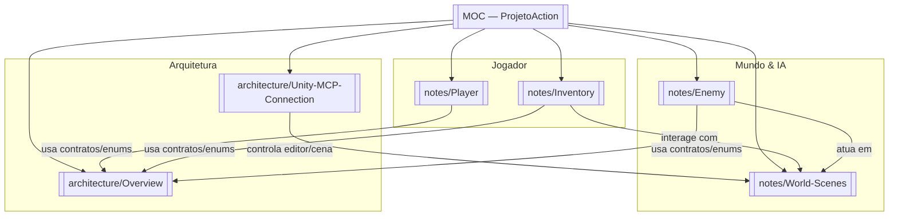

# MOC — ProjetoAction (Second Brain)

> Índice central do conhecimento do projeto Unity **ProjetoAction**.  
> Navegue pelos conceitos via [[wikilinks]] e pelo grafo de dependências abaixo.

## Visão geral

- **Engine**: Unity 6000.6.4f1
- **Cena principal**: `Assets/Scenes/SampleScene.unity`
- **Entrada**: `Assets/InputSystem_Actions.inputactions`
- **Domínio**: jogo em terceira pessoa com movimentação de personagem, inventário/mochila, itens coletáveis e inimigos com patrulha.

## Mapa de notas

### Núcleo do jogador
- [[notes/Player]] — movimento, câmera, olhar, mão, animação e perfil de tamanho.
- [[notes/Inventory]] — mochila, coleta e contratos de itens.

### IA e mundo
- [[notes/Enemy]] — comportamento e patrulha de inimigos.
- [[notes/World-Scenes]] — cenas, prefabs, materiais e assets.

### Arquitetura e integração
- [[architecture/Overview]] — contratos, enums, organização de scripts e fluxo de dados.
- [[architecture/Unity-MCP-Connection]] — conexão do editor Unity via Unity Pipeline / MCP CLI.

## Grafo (MOC)

## Convenções deste Second Brain

- Notas em `docs/notes/` capturam conceitos estáveis (alto nível), não micro-funções.
- Notas em `docs/architecture/` registram decisões, fluxos e integrações.
- Links usam `[[wikilinks]]` para navegação bidirecional conceitual.
- Diagramas Mermaid representam fluxos principais para localizar dependências rápido.
