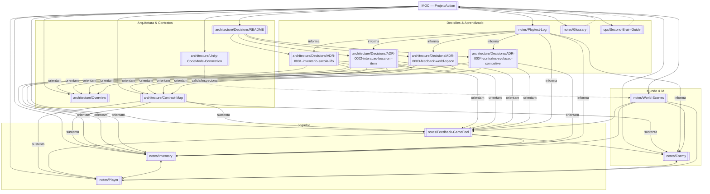

# MOC — ProjetoAction (Second Brain)

> Hub central do conhecimento do projeto Unity **ProjetoAction**. Navegue por [[wikilinks]] e pelo grafo para localizar conceitos, contratos, decisões e aprendizados.

## Estado atual (snapshot)

- **Engine:** Unity 6000.6.4f1
- **Cena principal:** `Assets/Scenes/SampleScene.unity` (`InputSystem_Actions.inputactions`)
- **Domínio:** ação/aventura em terceira pessoa com rato — movimento, interação pela **boca** (1 item), **sacola LIFO** (tensão cômica), itens utilizáveis e inimigos com patrulha/ataque.
- **Conexão com o Editor:** **Code Mode** (ferramenta única + conector `unity` sobre o Pipeline CLI), **verificado em 2026-11-17** — editor PID 14040, porta **7801**, `ready`, 196 comandos no catálogo. Detalhes: [[architecture/Unity-CodeMode-Connection]]. MCP: substituído por [[architecture/Decisions/ADR-0005-codemode-em-vez-de-mcp]].
- **Foco de design registrado:** feedback prioritariamente world-space/cena/câmera, HUD 2D mínimo, placeholders simples e sinalização 3D de dano/estado (jogador e inimigos). Ver [[notes/Feedback-GameFeel]] e ADRs.
- **Último aprendizado registrado:** integração via Code Mode validada (execução composta, descoberta e guarda de comandos destrutivos) em [[notes/Playtest-Log]].

## Mapa de navegação

### Núcleo do jogador
- [[notes/Player]] — movimento, câmera/olhar, boca (1 item), animação, vida e feedback.
- [[notes/Inventory]] — sacola LIFO, coleta, uso/reload/arremesso e legibilidade.
- [[notes/Feedback-GameFeel]] — vida baixa, feedback de uso/falha, pistas visuais 3D e prompts.
- [[notes/Dialogos-NPC]] — conversas com NPCs: marcador/aura, câmera cinematográfica, texto 3D e bloqueio do jogador (plano + estado atual).

### IA e mundo
- [[notes/Enemy]] — navegação/patrulha, ataque, animação e sinalização de estado.
- [[notes/World-Scenes]] — `SampleScene`, prefabs/assets, integração e validação.
- [[notes/Cozinha-Biomas]] — plano de design da cozinha: interiores de armários/balcões, pontes de rato e biomas (tropical, infernal, congelado, úmido).
- [[notes/Cozinha-Armarios-Balcoes]] — plano focado (2026-11-20) só em **armários e balcões**: medições atuais, receitas ProBuilder de gaveta/porta/nicho, distribuição nas 18+5 peças, ocupação rata e biomas nos móveis.

### Arquitetura, contratos e integração
- [[architecture/Overview]] — estrutura, fluxos e princípios.
- [[architecture/Contract-Map]] — mapa de `Contracts.cs`/`Enuns.cs` (atual vs planejado).
- [[architecture/Unity-CodeMode-Connection]] — conexão e operação do editor via Code Mode (`tools/unity-codemode`).
- [[architecture/Unity-MCP-Connection]] — nota substituída (histórico do caminho MCP).
- [[architecture/Decisions/README]] — índice de ADRs e template.

### Decisões & aprendizado
- [[architecture/Decisions/ADR-0001-inventario-sacola-lifo]] — sacola LIFO intencional.
- [[architecture/Decisions/ADR-0002-interacao-boca-um-item]] — boca, um item por vez.
- [[architecture/Decisions/ADR-0003-feedback-world-space]] — feedback world-space/câmera, HUD mínimo.
- [[architecture/Decisions/ADR-0004-contratos-evolucao-compativel]] — evolução não-destrutiva de contratos.
- [[notes/Playtest-Log]] — registro datado de testes e achados.
- [[notes/Glossary]] — termos canônicos do domínio.
- [[ops/Second-Brain-Guide]] — como usar e manter este Second Brain.

## Grafo (visão executável)

## Tarefas de conhecimento (manutenção leve)
- [ ] Após mudar `Contracts.cs`/`Enuns.cs`: atualizar [[architecture/Contract-Map]] e citar ADR se aplicável.
- [ ] Após decisão de design: registrar/atualizar ADR em [[architecture/Decisions/README]].
- [ ] Após playtest/smoke: adicionar entrada em [[notes/Playtest-Log]].
- [ ] Se estado do editor/Pipeline mudar: atualizar [[architecture/Unity-CodeMode-Connection]].
- [ ] Ao evoluir feedback/inventário/interação: manter notas de domínio e status (atual vs planejado) coerentes.
- [ ] Ao construir partes da cozinha: mover o item correspondente de [[notes/Cozinha-Biomas]] de planejado para atual.

## Convenções deste Second Brain
- Notas em `docs/notes/` capturam conceitos estáveis (alto nível), não micro-funções.
- `docs/architecture/` registra estrutura, contratos, integração e decisões (ADRs).
- `[[wikilinks]]` conectam conceitos; Mermaid mapeia fluxos principais.
- ADRs e [[notes/Playtest-Log]] são rastros de decisão/aprendizado (append-only quando aplicável).
- Marcar explicitamente **atual** vs **planejado/aprovado** para evitar doc rot.
- Guia completo: [[ops/Second-Brain-Guide]].