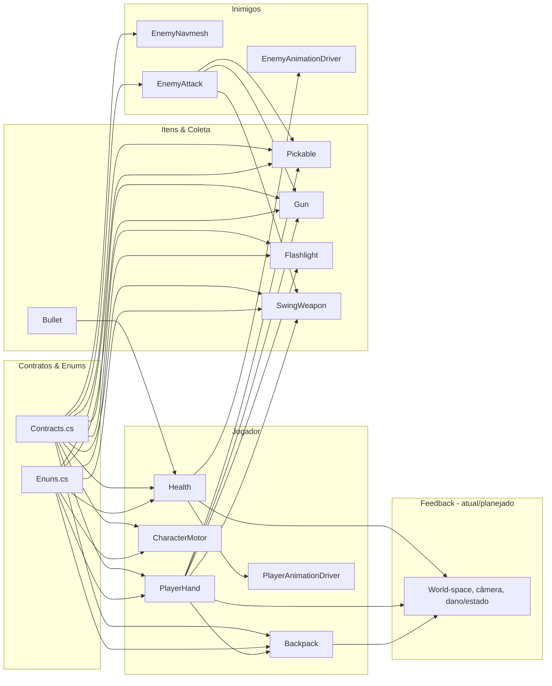

# Contract Map — Contratos e Enums

Mapa de `Assets/Scripts/Contracts.cs` e `Assets/Scripts/Enuns.cs`: propósito, implementadores/consumidores conhecidos e estado. Complementa [[architecture/Overview]] e as decisões em [[architecture/Decisions/README]].

> **Legenda de estado:** `Atual` = presente no código hoje. `Planejado/Aprovado` = definido em ADR/plano, ainda não consolidado no código (ver ADRs).

## 1. Interfaces (`Contracts.cs`) — estado atual

| Interface | Propósito | Implementadores conhecidos | Consumidores conhecidos | Estado |
|---|---|---|---|---|
| `IDamageable` | Receber dano (`ReceberDano(int)`) | `Health` | `Bullet` (aplica dano), `EnemyAttack` (dano melee), sistemas de combate | Atual |
| `IHealth` | Leitura/ação de vida (`Current`, `Max`, `IsDead`, `Heal`) | `Health` | UI/feedback (planejado), regras que consultam vida | Atual |
| `IPickable` | Ciclo segurar/soltar (`IsHeld`, `PickUp`, `Drop`) | `Pickable` | `PlayerHand`, `Backpack`, `EnemyAttack` | Atual |
| `IHoldListener` | Reagir a pegar/soltar | Componentes em itens (ex.: `Flashlight`) | `Pickable` (notifica) | Atual |
| `IUsable` | Ação de uso (`void Use()` — assinatura preservada) | `Gun`, `Flashlight`, `SwingWeapon` | `PlayerHand`, `EnemyAttack` | Atual |
| `ISwingWeapon` | Marcador de arma de balanço/melee | `SwingWeapon` | `PlayerHand` (animação/fluxo), `EnemyAttack` (modo melee) | Atual |
| `IReloadable` | Recarregar (`Reload`) | `Gun` | `PlayerHand` | Atual |
| `IMoveInput` | Entrada de movimento/salto | `PlayerMoveInput` | `CharacterMotor` | Atual |
| `ILockable` | Travar/destravar controle (`Locked`) | `CharacterMotor` (e outros conforme uso) | `Health` (stun/morte) | Atual |
| `IRatSized` | Expor tamanho do rato (`RatSize`) | (a mapear conforme implementação) | Sistemas de escala/comportamento (ex.: `RatSizeProfile`) | Atual |

## 2. Enums (`Enuns.cs`)

| Enum | Propósito | Uso atual / esperado | Estado |
|---|---|---|---|
| `RatSize` | Faixas de tamanho (`Mini`…`Big`) | Perfil/escala e regras dependentes de tamanho | Atual |
| `Effects` | Efeitos de estado (veneno, stun, etc.) | Reservado para condições; integrar quando efeitos forem aplicados | Atual |
| `UseResult` | Resultado de tentativa de uso (`Success`, `Empty`, `Cooldown`, `Blocked`, `NoTarget`, `Failed`) | Base semântica para feedback de uso/falha | Atual (vocabulário), integração via contratos/eventos: Planejado/Aprovado |
| `ItemCategory` | Categoria simples de item | Metadados/prompt de itens | Atual (vocabulário), integração: Planejado/Aprovado |
| `FeedbackCue` | Tipo de ação/estado para feedback | Cues world-space/câmera (pegar, guardar, usar, vazio, dano, etc.) | Atual (vocabulário), integração: Planejado/Aprovado |

## 3. Evoluções planejadas/aprovadas (compatíveis)

Conforme [[architecture/Decisions/ADR-0004-contratos-evolucao-compativel]], [[architecture/Decisions/ADR-0001-inventario-sacola-lifo]], [[architecture/Decisions/ADR-0002-interacao-boca-um-item]] e [[architecture/Decisions/ADR-0003-feedback-world-space]]:

| Elemento | Propósito | Consumidores/Produtores previstos | Estado |
|---|---|---|---|
| `IInteractable` (+ foco/`FocusTransform`) | Unificar foco e acionamento de interagíveis no mundo | `PlayerHand`/detector de foco, `Pickable`, prompts/highlight 3D | Planejado/Aprovado |
| Contrato/eventos de inventário (LIFO) | Expor contagem/capacidade/topo e eventos `Stored/Retrieved/Changed` sem quebrar semântica da sacola | `Backpack`, `PlayerHand`, feedback de inventário | Planejado/Aprovado |
| `IUseResultProvider` / eventos de uso | Reportar `UseResult` e tentativas sem mudar `IUsable.Use()` | Itens (`Gun`, `Flashlight`, `SwingWeapon`), `PlayerHand`, feedback | Planejado/Aprovado |
| `IAmmoProvider` | Estado de munição/recarga (`Current/Reserve/Clip/IsReloading`, eventos) | `Gun`, feedback de uso/reload | Planejado/Aprovado |
| `ITogglable` | Estado on/off e evento de toggle | `Flashlight`, feedback | Planejado/Aprovado |
| `IItemInfo` | Nome/categoria para prompt e identificação | `Pickable`/itens, cues world-space | Planejado/Aprovado |
| Sinalização 3D de dano/estado | Indicadores visuais a partir de `Health`/eventos para player e inimigos | `Health`, `DamageStateIndicator3D` (planejado), feedback | Planejado/Aprovado |

## 4. Grafo de dependências (conceitual)

## 5. Regras de manutenção
- Ao alterar `Contracts.cs` ou `Enuns.cs`, atualizar este mapa (tabelas, estado e grafo).
- Mudança de semântica/assinatura relevante deve referenciar um ADR em [[architecture/Decisions/README]].
- Marcar explicitamente **Atual** vs **Planejado/Aprovado/Concluído** para evitar doc rot.
- Manter exemplos de implementadores/consumidores em nível de componente (não listar todos os métodos).
