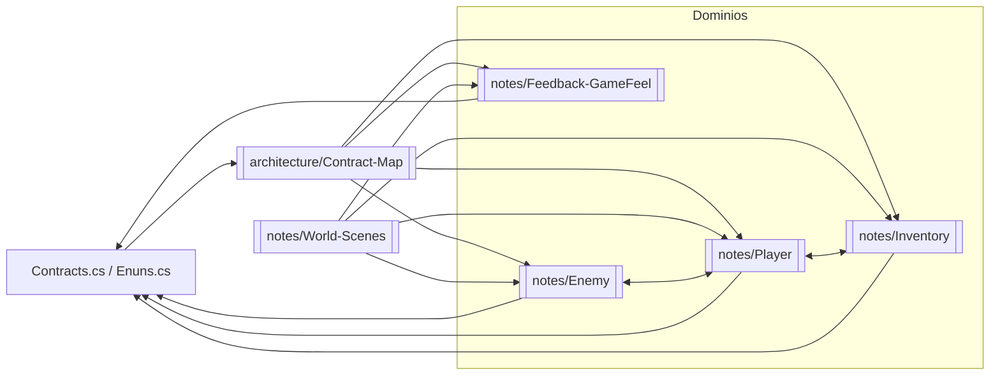

# Architecture Overview

Visão de alto nível da organização do código em `Assets/Scripts` e dos fluxos principais do **ProjetoAction**. Índice: [[MOC]].

## Estrutura de código

- **Raiz de scripts:** motor e sistemas do jogador, vida, coleta, contratos e enums.
  - `Contracts.cs` — interfaces e contratos compartilhados (dano, vida, interação/itens, input, lock, tamanho).
  - `Enuns.cs` — enumerações do domínio (`RatSize`, `Effects`) e vocabulário de feedback (`UseResult`, `ItemCategory`, `FeedbackCue`).
  - `CharacterMotor.cs`, `PlayerMoveInput.cs`, `PlayerLook.cs`, `PlayerHand.cs`, `PlayerAnimationDriver.cs`, `CameraEffects.cs`, `Health.cs`, `Backpack.cs`, `Pickable.cs`, `RatSizeProfile.cs`, `PatrolNode.cs`.
- **`Scripts/Enemy/`:** `EnemyNavmesh.cs`, `EnemyAttack.cs`, `EnemyAnimationDriver.cs`.
- **`Scripts/Itens/`:** `Gun.cs`, `Bullet.cs`, `Flashlight.cs`, `SwingWeapon.cs`.

## Contratos centrais
- Mapa detalhado (estado atual vs planejado): [[architecture/Contract-Map]].
- Princípio: contratos e enums centralizados para reduzir acoplamento; evolução **compatível/não-destrutiva** quando possível (ver [[architecture/Decisions/ADR-0004-contratos-evolucao-compativel]]).

## Decisões-chave (ADRs)
- [[architecture/Decisions/ADR-0001-inventario-sacola-lifo]] — sacola LIFO intencional (tensão cômica).
- [[architecture/Decisions/ADR-0002-interacao-boca-um-item]] — pegar/segurar com a boca, 1 item ativo.
- [[architecture/Decisions/ADR-0003-feedback-world-space]] — feedback em world-space/cena/câmera, HUD 2D mínimo, placeholders simples, sinalização 3D de dano/estado.
- [[architecture/Decisions/ADR-0004-contratos-evolucao-compativel]] — preservar `IUsable.Use()` e evoluir por eventos/canais paralelos.
- Índice completo: [[architecture/Decisions/README]].

## Domínios e fluxos

- [[notes/Player]] — input, movimento, câmera/olhar, interação (boca), animação, vida e feedback.
- [[notes/Inventory]] — sacola LIFO, coleta, uso/reload/descartar de itens.
- [[notes/Enemy]] — patrulha/navegação, ataque, animação e sinalização de estado.
- [[notes/World-Scenes]] — composição em cena (`SampleScene`), prefabs/assets e integração.
- [[notes/Feedback-GameFeel]] — vida baixa, feedback de uso/falha, pistas visuais 3D e prompts.
- [[notes/Playtest-Log]] — evidências de testes e aprendizados.

## Integração e ferramentas
- Conexão editor/ferramentas: [[architecture/Unity-MCP-Connection]] (Pipeline/MCP CLI, porta 7800, estado verificado).
- Manutenção do conhecimento: [[ops/Second-Brain-Guide]].

## Fluxo de dependências (conceitual)

## Princípios observados
- Separação por domínio (Player, Enemy, Itens/Inventário, Feedback).
- Contratos e enums centralizados; decisões registradas em ADRs.
- Evolução incremental a partir de cena única (`SampleScene`) com validação via playtest/Pipeline.
- Conhecimento de alto nível mantido no Second Brain (evitar espelhar micro-funções).