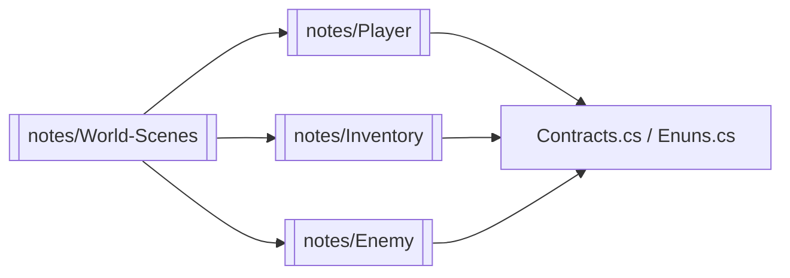

# Architecture Overview

Visão de alto nível da organização do código em `Assets/Scripts`.

## Estrutura

- **Raiz de scripts**: motor e sistemas do jogador, vida, coleta, contratos e enums.
  - `Contracts.cs` — contratos/interfaces/tipos compartilhados.
  - `Enuns.cs` — enumerações do domínio.
- **`Scripts/Enemy/`**: navegação, ataque e animação de inimigos.
- **`Scripts/Itens/`**: armas, projéteis e ferramentas.

## Princípios observados

- Separação por domínio (Player, Enemy, Itens/Inventário).
- Contratos e enums centralizados para reduzir acoplamento implícito.
- Evolução incremental a partir de cena única (`SampleScene`).

## Relações

- [[notes/Player]] — consumo de input, movimento e interação.
- [[notes/Inventory]] — mochila e itens.
- [[notes/Enemy]] — IA e combate.
- [[notes/World-Scenes]] — composição na cena.

## Fluxo de dependências (conceitual)

