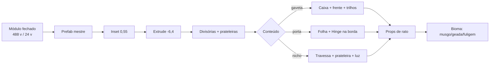

# Cozinha — Plano focado: Armários e Balcões (v3, pós-ProBuilder)

> **Tipo:** plano de design + execução. **P0 em 2026-11-20**; **P1 em 8 móveis** (3 em §16, 5 em §17); **pontes e estruturas de rato em §18**. A torre de canto oeste e o P2 em diante não foram iniciados.
> **Escopo desta parte:** **somente os 18 balcões e os 5 armários** — geometria, aberturas, interiores, ocupação rata ancorada neles e tratamento de bioma/abandono nas suas superfícies. Fogão, geladeira, pias, mesa e o sistema completo de pontes/iluminação ficam fora (aparecem apenas como *restrição* ou *âncora*).
> **Cena:** `Assets/Scenes/SampleScene.unity` → `COZINHA/Moveis`. Medições de **2026-11-20**, lidas do YAML da cena + hierarquia do Editor.
> **Documentos irmãos:** [[notes/Cozinha-Biomas]] (plano geral, biomas e pontes) · [[notes/World-Scenes]] · [[MOC]].

---

## 1. Como ler este documento

1. **§2** é o raio-X medido — só o que existe hoje.
2. **§3–§4** é o diagnóstico e a tese de design (por que os móveis precisam mudar).
3. **§5** são as receitas ProBuilder, com números e operações.
4. **§6–§8** são o catálogo de peças, a distribuição nas 18+5 peças e o que vive dentro/em cima delas.
5. **§9–§10** aplicam bioma, vegetação e luz **nas superfícies dos móveis**.
6. **§11–§13** são fases, riscos e o roteiro da primeira sessão.

Regra de leitura de coordenadas: **`y′` = altura a partir do piso da cozinha**. Medição ao vivo de 2026-11-20: **piso em y = 0**, então `y = y′`. X e Z são os do mundo.

---

## 2. Estado atual medido (2026-11-20)

### 2.1 Organização

A cena foi reorganizada desde o último plano: `COZINHA` agora tem **3 grupos** — `Arquitetura`, `Eletrodomesticos`, `Moveis` — e **94 GameObjects** no total. Os móveis estão todos soltos dentro de `Moveis`:

- **18 `Balcao`** — 16 retos + 2 torres de canto.
- **5 `Armario`** — 4 malhas soltas + **1 instância de prefab** (`Assets/Prefabs/Armario_A5.prefab`, em `-37,25 / 24`).
- 4 `Cadeiras`, 1 `Mesa`, 1 `Vassoura` (com `Cabeça/Cabelo`).

Fora de `COZINHA` existe uma raiz `AREA_NEVE` (Ground + `AlvoGelo` + blocos `Gelo`) — o primeiro bioma já começou a ser montado fora da cozinha. Os móveis ainda não receberam nada disso.

### 2.2 Medidas reais da marcenaria

Piso **y′ = 0** · teto **y′ = 32,76** · pé-direito **32,76**.

| Peça | Qtd | Dimensões (L × A × P) | Faixa vertical | Face para o salão |
|---|---|---|---|---|
| `Balcao` padrão | 14 | 10 (ou 12 nas pontas) × 10 × 10,66 | y′ 2,52 → 12,52 | z = −32,56 (norte) · x = ±31,9 (laterais) |
| `Balcao` torre de canto | 2 | 10,5 × 13,52 × 10,5 | y′ −1,00 → 12,52 (enterrada 1,0; topo igual aos demais) | duas faces internas (x = ±32 / z = −31,5) |
| `Balcao` alto das pontas | 2 | 10 × 13,02 × 10,66 | y′ −0,51 → 12,52 (topo igual aos demais) | x = ±31,9 em z = 35 |
| `Armario` | 5 | comp. 20 / 25 / 30 / 50 / 70 × 10 × 10 | y′ 22,0 → 32,0 | z = −32 (norte) · x = ±32 (laterais) |

**Posições exatas**

| Fila | Módulos (centro) | Vão ocupado | Face |
|---|---|---|---|
| Norte | x = −25 (12 largo), −15, −5, 5, **25 (12 largo)** | −32 → 32 | z = −32,56 |
| Oeste | z = −25 (12), −15, −5, 15, 25, 35 (alto) | −30 → 40 | x = −31,9 |
| Leste | z = −25 (12), 5, 15, 25, 35 (alto) | −30 → 40 | x = +31,9 |
| Cantos | (−37/−37) e (37/−37) | 10,5 × 10,5 | internas |

> A fila norte tem **vazio de x = 10 a 20** (fogão). A leste, o vazio de **z = −20 a 0** são as duas pias. A oeste, o vazio de **z = −1 a 11** é a geladeira — e ela **invade 1,0 un** os balcões de z = −5 e z = 15 (§2.5).

**Armários, um por um**

| ID | Centro | Comprimento | Vão | Face |
|---|---|---|---|---|
| A1 | (−17,25 / −37) | 50 | x −42,25 → 7,75 | z = −32 |
| A2 | (32 / −37) | 20 | x 22 → 42 | z = −32 |
| A3 | (−37,25 / −17) | 30 | z −32 → −2 | x = −32,25 |
| A4 | (37 / 3) | 70 | z −32 → 38 | x = +32 |
| A5 | (−37,25 / 24) | 25 | z 11,5 → 36,5 | x = −32,25 (**prefab**) |

- **Vão A1 ↔ A2:** x 7,75 → 22 = **14,25** de vão, sobre o fogão (topo do fogão em y′ 13,0). É a "rua alta" principal.
- **Vão A3 ↔ A5:** 13,5 no total, **preenchido no meio pelo topo da geladeira** (y′ 27,0, z −1 → 11) — dois saltos curtos de 1,0 e 0,5.
- **Vão tampo ↔ armário:** **9,48** em todo o U (y′ 12,52 → 22,0).
- **Folga armário ↔ teto:** **0,76** — cabe o rato, **não cabe a câmera**.

### 2.3 Materiais, colisão, prefabs

| Item | Estado |
|---|---|
| Balcões | malha ProBuilder **fechada**, 488 vértices / 108 faces (torres: 192/45; pontas: 578/129) |
| Armários | malha ProBuilder **fechada**, **24 vértices / 6 faces = cubo maciço** |
| Materiais | balcões: `BlackConcrete` + `WhiteConcrete`; armários: só `BlackConcrete`; **A5 usa um material próprio** |
| Colisão | `MeshCollider` em cada móvel; nenhum prop |
| Static | **todos** com `StaticEditorFlags = 2147483647` (tudo ligado, inclusive batching) |
| Filhos | **0** em todos os balcões e nos 4 armários soltos; A5 também não tem portas |
| Prefabs | só **A5** é instância; os outros **22 móveis são cópias independentes** |
| Luz | **1 direcional** no mundo inteiro; nenhuma luz local, nenhum probe |
| Materiais orgânicos | **não existem** (`Moss`, `Rust`, `Dust`, `InteriorDark`…) |

### 2.4 Escala de leitura

Cápsula do `Player`: **0,8 de comprimento, ~0,32 de altura** → **1 un ≈ 8 cm** de rato.

| Referência | Unidades | Leitura |
|---|---|---|
| Rato (comprimento) | 0,8 | 1 rato |
| Fresta sob o balcão | 2,52 | ~3 ratos empilhados — túnel pronto |
| Altura do balcão | 10 | ~12 ratos — penhasco |
| Vão tampo ↔ armário | 9,48 | ~12 ratos |
| Profundidade útil de nicho | 6,4 | ~8 ratos — navegável |
| Altura de armário | 10 | ~12 ratos — 3 andares de rato |

> Regra: **tudo que é detalhe nasce em múltiplos de 0,5–1 un**. Se passar de 3 un, já não é objeto de rato, é arquitetura humana.

### 2.5 Defeitos que atrapalham antes de detalhar

| # | Defeito | Medida | Correção |
|---|---|---|---|
| 1 | **Geladeira invade os balcões vizinhos** | 1,0 un em z = −5 e z = 15 | mover a geladeira 1,0 para z ou encurtar os dois módulos — **antes** de abrir as faces desses dois |
| 2 | **Rodapé inexistente** | face começa em y′ 2,52, sem recuo | acrescentar plinto recuado 0,30 (y′ 2,52 → 3,00) em todos |
| 3 | **Face lisa e contínua** | módulos encostados, sem junta | junta escura de 0,06 entre módulos |
| 4 | **4 armários sem prefab** | 22 cópias soltas | prefab do balcão e do armário **antes** de editar mais de 3 peças |
| 5 | **Armário colado no teto** | 0,76 de folga | cove de 2,5 no forro sobre o U (pré-requisito para as pontes de topo) |
| 6 | **A5 fora do padrão** | material e pivô diferentes | reverter para o prefab mestre e reaplicar como variante |
| 7 | Sem NavMesh nas superfícies elevadas | bake só no `Ground` | inofensivo nesta fase (props de detalhe), mas re-assar ao final |

---

## 3. Diagnóstico de design

**O que já funciona e não deve ser mexido**

1. **Escala de colosso** — 88 × 88 com bancada de 12,52: a fantasia de rato está resolvida.
2. **Circuito em U** — corredor de 9,48 entre tampo e armários, subsolo de 2,52 contínuo nos três lados.
3. **Ritmo de alturas** — 2,52 (fresta) / 12,52 (tampo) / 22–32 (armário) / 32,76 (teto). É uma cidade em quatro níveis esperando ser ocupada.
4. **Duas torres de canto** — os únicos volumes que quebram a linha; são marcos naturais.
5. **Biomas já ancorados nos vizinhos** — água (pias), gelo (geladeira), fogo (fogão), sombra (fresta). Os móveis são o **tecido entre** os biomas.
6. **Tudo é ProBuilder** — cavar um interior é `Inset + Extrude` no próprio objeto, com collider automático. O gargalo antigo (Blender) não existe mais.

**O que trava a leitura de "civilização vivendo aqui há muito tempo"**

1. **Nada tem dentro.** 24 vértices por armário = cubo maciço. Sem cavidade, o olho não encontra "dentro", e sem dentro não há história.
2. **A fachada não tem ritmo.** 14 balcões idênticos, face única, sem porta, gaveta, junta ou puxador. Lê como *blockout*, não como marcenaria.
3. **Zero escala média.** Entre o chão e o tampo não existe nada — a camada onde a vila acontece está vazia.
4. **Zero vocabulário de rato.** Nenhum palito, barbante, rolha, caixa de fósforo. Nada foi "construído por bichos".
5. **Zero natureza.** Sem musgo, ferrugem, poeira, teia: o abandono não tem como aparecer.
6. **Repetição sem variação.** 22 cópias independentes: qualquer correção custa 22 vezes e qualquer detalhe se repete igual.
7. **A fresta é boa, mas invisível.** O túnel de 2,52 existe e é contínuo — mas é escuro, liso e sem boca. Falta entrada, musgo e luz.
8. **Interior preto.** Com uma única direcional e sem probe, qualquer nicho vira mancha chapada. Interior precisa de luz própria.

---

## 4. Tese e princípios

> **Os móveis são a cidade.** O balcão é um quarteirão de 10 × 10 com 2,52 de subsolo e 12,52 de cobertura; o armário é o distrito alto, com três andares e vista para o salão; as torres de canto são os marcos; a fresta é o metrô.

**Três camadas, sempre nesta ordem**

1. **Arquitetura humana** — geométrica, dura, repetida, grande. Já existe.
2. **Ocupação rata** — aberturas roídas, gavetas viradas em feira, portas entreabertas, casinhas de fósforo, pontes de palito. É o grosso deste plano.
3. **Natureza retomando** — musgo na soleira, geada no flanco, fuligem na lateral, poeira no topo. É a cola que data tudo.

**Cinco princípios**

1. **Silhueta antes de textura.** Uma porta a 25° e uma gaveta 3 un para fora precisam ser legíveis em preto puro, a 10 un.
2. **Regra do ⅓.** Para 18 balcões: **9 com abertura real, 4 com marca de uso, 5 intactos**. Nos 23 vãos de armário: ~9 abertos. Nunca abrir tudo — senão vira casa de boneca.
3. **Três níveis de leitura.** 10 un (ritmo das fachadas) · 2 un (o que tem dentro) · 0,5 un (mordida, parafuso, barbante).
4. **Módulo antes de peça única.** 6 fachadas em prefab, repetidas com rotação e conteúdo diferente, valem mais que 24 peças únicas.
5. **Nada sem colisão pensada.** Ou o rato entra/passa, ou é cenário fora de rota. Nunca um vão que parece passagem e não é.

**Vocabulário (a troca que conta a história)**

| Onde | Conteúdo |
|---|---|
| Dentro dos móveis **humanos** (armário, gaveta grande) | potes de vidro, latas, sacos de cereal, formigas, panos |
| Dentro dos nichos **de rato** (buracos, casinhas) | caixa de fósforo, rolha, carretel, tampinha, pregador, clipe, palito, botão, barbante |
| Nas superfícies | poeira, trilhas, anéis de calcário, cinza, geada, musgo |
| Nas quinas | teia (sempre quina, nunca no meio) |

---

## 5. Receitas ProBuilder

> Ferramenta: **ProBuilder 6.1.4** (já no projeto). Todas as operações são no próprio objeto, sem Blender. Antes de qualquer cirurgia: **duplicar o módulo, aplicar a escala e salvar como prefab** — nunca editar as 18 cópias.

### 5.1 Cavidade (o interior) — base de tudo

Funciona em `Balcao`, `Armario` e nas torres.

1. Selecionar o módulo → **ProBuilder Window** → modo **Face**.
2. Clicar na **face frontal** (a que olha para o salão).
3. **Inset** com `Amount = 0,55` (cria o batente; o miolo continua selecionado).
4. **Extrude** com `Distance = −6,4` (negativo = para dentro). Nasce o nicho: 4 paredes + fundo.
5. Conferir as faces internas: se alguma ficar preta, **Flip Normals** só nela.
6. **Triangulate** nas faces que receberam vértices movidos ($5.6).
7. Colisor: manter `MeshCollider` **convexo desligado** (é estático) — o rato passa a entrar e não atravessa.

| Módulo | Profundidade total | Cavidade | Casca restante |
|---|---|---|---|
| Balcão | 10,66 | **6,4** | 4,26 |
| Armário | 10,0 | **6,2** | 3,8 |
| Torre de canto | 10,5 | 6,4 | 4,1 |

> Nunca passar de **6,8**: o fundo do nicho encostaria na parede da sala.

**Faixas verticais (balcão, face de 2,52 a 12,52)**

| Faixa | y′ | Uso |
|---|---|---|
| Plinto | 2,52 → 3,00 | recuo de 0,30 (novo, §5.7) |
| Portas / gavetas baixas | **3,00 → 8,30** | 5,3 de altura — 2 portas ou 1 gaveta alta |
| Travessa fixa | 8,30 → 8,60 | separa os andares |
| Gaveta | **8,60 → 11,50** | 2,9 de altura |
| Borda do tampo | 11,50 → 12,52 | 1,0 — estrutura visível |

**Faixas verticais (armário, face de 22,0 a 32,0)**

| Faixa | y′ | Uso |
|---|---|---|
| Base | 22,0 → 22,5 | batente inferior |
| Andar 1 | **22,5 → 25,2** | casinha de rato (1,2 + 1,5 de folga) |
| Prateleira | 25,2 → 25,5 | 0,3 |
| Andar 2 | **25,5 → 27,9** | potes/caixas |
| Prateleira | 27,9 → 28,2 | 0,3 |
| Andar 3 | **28,2 → 31,5** | estoque, vila, teia |
| Coroamento | 31,5 → 32,0 | 0,5 (novo, §5.7) |

### 5.2 Subdivisões internas (sem recortar a malha de novo)

Uma cavidade só, dividida por peças soltas (mais robusto que recortar sub-faces):

- **Travessa** — Cube `8,9 × 0,45 × 6,3` em y′ 8,45, encostada no fundo. Separa gaveta de portas.
- **Prateleira** — Cube `8,9 × 0,30 × 6,0`, recuada 0,4 da boca (a sombra cria profundidade).
- **Montante** — Cube `0,45 × 5,3 × 6,2` no centro, quando o vão tem duas portas.
- No armário, **duas prateleiras** em 25,35 e 28,05, largura do vão − 0,4.
- Todas as peças internas com `Wood` ou `WoodOld`; o fundo com `InteriorDark` (§5.9).

### 5.3 Gaveta puxada

1. **Caixa:** Cube `8,0 × 2,7 × 5,8`; face superior → **Inset 0,35** → **Extrude −1,9** (fundo de 0,8).
2. **Frente:** Cube `8,7 × 3,0 × 0,35`, colada na boca.
3. **Puxador:** Cube `1,6 × 0,25 × 0,25` (ou Cylinder 8 lados achatado) a 0,25 da frente.
4. **Trilhos:** 2 Cubes `5,4 × 0,18 × 0,18` + 2 travessas `0,18 × 0,18 × 5,8` em `Iron`.
5. **Posição:** puxar **3,0 a 3,4** no eixo normal (≈ 32% do curso) e **1,5 abaixo** da boca do nicho.
6. Pivô na **base-centro**; agrupar como `Gaveta_*`; salvar prefab.

> Gaveta **caída** (abandono): mesma caixa, girada 8° em Z, 76° em X, apoiada no chão; a frente virada para cima vira **prateleira** e o conjunto vira **degrau** para a subida do rato.

### 5.4 Porta com dobradiça

1. **Folha:** Cube `largura × altura × 0,35`; **Bevel 0,04** nas 4 arestas (pega luz).
2. **Empty `Hinge_*`** exatamente na **borda** da folha, no meio da altura.
3. Parentear a folha ao Empty e ajustar `localPosition = (+largura/2, 0, 0)` → gira pela quina.
4. Rotacionar o **Empty** em Y: **22°–30°**. Acima de 45° vira convite óbvio; abaixo de 15° lê fechada.
5. **Dobradiças:** 2 cilindros `0,22 × 0,5` em `Iron`, no eixo.
6. **Porta arrancada:** Empty a 70–80°, folha deslocada 0,5 em Y e 8° em Z; uma dobradiça caída no chão.
7. **Porta empenada** (calor do fogão): 2 vértices do canto oposto movidos 0,15 na normal — sem triangulate fica torto de verdade.

> O pivô na borda é o que separa "porta entreaberta" de "placa solta".

### 5.5 Porta com buraco de rato

Não recortar a folha de 0,35: **montar a porta com 4 peças** (2 montantes + 2 travessas) em volta do vão.

- Vão: **1,1 × 1,1**, com o fundo na borda inferior da folha.
- Batente do buraco: 4 tiras `0,12 × 0,12 × 0,35` em `Iron` (ou `Wood` roído).
- Mordidas: 3 meias-luas de 0,25 no batente (plano curvo/`Cylinder` fatiado).
- Resultado: a porta continua legível como porta e ganha uma **passagem de rato** para dentro do armário.

### 5.6 Buraco roído

O balcão não tem rodapé — o buraco é na **parte baixa da face**, não no piso.

1. Face frontal → **Inset 0,9** (na região baixa) → **Extrude −4,5**.
2. **Bevel 0,12** na boca.
3. Mover 3–4 vértices da boca em 0,15–0,30 (irregular).
4. **Triangulate**; conferir normais.
5. Serragem: Plane `2,0 × 2,0` com `MossDry` 0,02 acima do piso; 3 marcas de dente (meias-luas 0,25).

> O buraco é a **boca do subsolo**. Sempre alinhado com a fresta de 2,52, nunca no meio da face.

### 5.7 Plinto, soleira e coroamento (o que faz o móvel "pisar")

| Peça | Medida | Onde | Por quê |
|---|---|---|---|
| **Plinto** | recuo 0,30; altura 0,48 (y′ 2,52 → 3,00) | todos os balcões | cria sombra na base e uma linha de escala |
| **Soleira** | faixa 0,10 × 0,6 × 0,4 em `Iron` | pés dos balcões e armários | ferrugem + musgo têm onde crescer |
| **Coroa** | `0,35 × 0,35` em toda a borda superior do armário | A1–A5 | esconde a folga de 0,76 e dá silhueta de marcenaria |
| **Rodapé roído** | 1,2 × 0,5, recuado 0,15 | 4 balcões | marca de dente + serragem |

### 5.8 Tampo, sombra e juntas

- **Sombra do tampo:** o tampo já avança 0,66 sobre o corpo. Colar uma faixa escura `10 × 0,18 × 0,05` sob a borda frontal → a linha horizontal aparece a 20 un.
- **Juntas verticais:** plano `0,06 × 9,0 × 0,02` em `InteriorDark` nos encontros entre módulos. Custa 2 tris e resolve o "parede contínua".
- **Chanfro de boca:** `Bevel 0,05` em todo o contorno do nicho, para a luz não sumir na aresta dura.

### 5.9 Materiais do kit (9 novos)

| Material | Uso | Base |
|---|---|---|
| `InteriorDark` | fundo de nicho, juntas, vão sob o balcão | preto fosco, sem brilho |
| `WoodOld` | porta de reposição, prateleira, gaveta | `Wood` mais escuro e dessaturado |
| `Rust` | dobradiças, trilhos, pés | `Iron` com mancha laranja |
| `MossWet` | soleira, buracos, pias | verde-escuro brilhante |
| `MossDry` | serragem, juntas secas, topo | verde-acinzentado fosco |
| `Dust` | topo de armário, tampo, prateleira | cinza claro, opaco |
| `Cardboard` | casinhas, remendos | marrom claro |
| `Fabric` | panos, cortinas de nicho | bege |
| `Ash` | perto do fogão, fundo de gaveta | cinza escuro |

> UV esticada nas faces novas é o risco nº 1 do ProBuilder: **usar material de cor lisa** no interior (sem textura) evita 90% do problema.

### 5.10 Quadro-resumo das operações

---

## 6. Catálogo de prefabs (6 fachadas + 2 bases)

| Prefab | Conteúdo | Onde nasce |
|---|---|---|
| `Balcao_Mestre` | módulo 10 × 10 × 10,66, 2 materiais, `MeshCollider` | base dos 18 |
| `Balcao_Torre` | variante 10,5 × 13,52 × 10,5 | 2 cantos |
| `Armario_Mestre` | 10 × 10 × 10, bays de 10, coroa | base dos 5 |
| `Fachada_GavetaPuxada` | caixa + frente + trilhos + puxador + 6 props | 4 balcões |
| `Fachada_PortaEntreaberta` | folha 25°, dobradiças, prateleira, 5 props | 10 lugares |
| `Fachada_PortaArrancada` | folha a 75°, 1 dobradiça no chão, teia | 3 lugares |
| `Fachada_NichoAberto` | travessa, 2 prateleiras, luz, 8 props | 3 lugares |
| `Fachada_BuracoRoído` | buraco 4,5 + serragem + mordidas | 3 balcões |
| `Fachada_PortaComBuraco` | porta em 4 peças + vão 1,1 × 1,1 | 1 armário (A1, vão 5) |

Convenções: pivô **base-centro**, escala 1, prefixo por sistema (`Gaveta_`, `Porta_`, `Nicho_`), luz filha do grupo.

---

## 7. Distribuição nas 18 peças + 5 armários

### 7.1 Balcões

**Abertura real (9)** — o jogador consegue ver dentro e, em 3 casos, entrar:

| # | Módulo | Intervenção | Conteúdo | Papel |
|---|---|---|---|---|
| 1 | norte x = −25 | gaveta dupla puxada + gaveta caída no piso | pregos, clipes, tampinhas | **degrau** da subida + oficina |
| 2 | norte x = −5 | buraco roído 2,4 × 2,2 + nicho baixo | serragem, ninho de papel | boca do subsolo (norte) |
| 3 | norte x = 5 | porta entreaberta 28° | potes, cereais, pano | transição para o fogão (fuligem) |
| 4 | oeste z = −25 | buraco roído + musgo na soleira | raízes, cogumelo | boca do subsolo (oeste) |
| 5 | oeste z = −15 | porta arrancada | latas, teia, pano | abandono do lado gelado |
| 6 | oeste z = −5 | porta entreaberta 24° | latas congeladas, gelo | vizinho da geladeira (geada) |
| 7 | leste z = −25 | porta entreaberta 30° | potes úmidos, vidros | **tropical** (pia) |
| 8 | leste z = 15 | gaveta puxada 40% | barracas, tampinhas-moeda | **Feira da Gaveta** |
| 9 | canto oeste (−37/−37) | porta entreaberta no andar alto (y′ 8,0–11,6) | vazio, silhueta | marco/gate visto do chão |

**Marca de uso, fechado (4):**

| # | Módulo | Marca |
|---|---|---|
| 10 | norte x = 25 | gaveta emperrada 0,5; puxador torto; mordidas no rodapé |
| 11 | oeste z = 15 | puxador faltando; junta remendada com fita |
| 12 | leste z = 5 | gaveta 0,6 fora, vazia; poeira na frente |
| 13 | leste z = 35 | porta desregulada 3°, fechada; dobradiça oxidada |

**Intactos (5):** norte x = −15, oeste z = 25, oeste z = 35 (alto), leste z = 25, canto leste (37/−37). Servem de respiro — e o canto leste ganha só **ninho de barbante no topo**.

> Cobertura: **9 aberturas / 4 marcas / 5 intactos = 50% / 22% / 28%** — perto do ⅓ e ainda generoso, porque o pedido é "ver vida" sem virar casa de boneca.

### 7.2 Armários

| ID | Vãos | Intervenções | Conteúdo | Papel |
|---|---|---|---|---|
| **A1** (50) | 5 × 10 | vão 1: porta 25° · vão 2: porta arrancada · vão 3: **nicho aberto** · vão 4: porta 30° · vão 5: porta fechada com **buraco de rato** 1,1 × 1,1 | potes, caixas, **vila de 3 casinhas**, teia | **Vila do Vão** — o interior principal, visível do chão |
| **A2** (20) | 2 × 10 | vão 1: porta 30° · vão 2: intacto com remendo de zinco | tampinhas empilhadas, carretel-torre | depósito |
| **A3** (30) | 3 × 10 | vão junto a z = −2: **nicho aberto** (atalho) · vão 2: porta 45° · vão 3: intacto | vazio com teia; 1 casa | **atalho de ponte** para o topo da geladeira |
| **A4** (70) | 7 × 10 | vãos 1 e 6: portas 25°/30° · vão 4: **nicho aberto** · 4 intactos | 4 "apartamentos" de rato, varal de barbante entre vãos | **prédios do leste** — leitura a 15 un |
| **A5** (25) | 2 × 12,5 | vão 1: porta arrancada · vão 2: intacto | sucata, telhado caído | abandono no alto |

> A5 é o único prefab; usar como **variante** (`Prefab Variant`) em vez de geometria própria, senão as próximas edições a deixam fora do padrão.

### 7.3 Contagem de trabalho

| Item | Quantidade |
|---|---|
| Cavidades novas | **20** (9 balcões + 11 vãos de armário) |
| Portas (entreaberta/arrancada) | **14** |
| Gavetas (puxada/caída) | **4** + 3 marcas de 0,5 |
| Buracos roídos | **3** |
| Nichos abertos | **3** |
| Plintos / juntas / coroas | 18 + 18 + 5 |
| Props de rato | **~120** (6–8 por abertura) |
| Luzes internas | **8** (1 a cada 2–3 aberturas) |

---

## 8. O que vive dentro e em cima (a civilização)

### 8.1 Kit de tralha (tudo entre 0,6 e 2,5)

| Peça | Primitiva ProBuilder | Medida |
|---|---|---|
| Rolha | Cylinder | 0,8 × 1,2 |
| Tampinha | Cylinder achatado | 0,9 × 0,15 |
| Caixa de fósforo | Cube | 2,0 × 0,7 × 1,3 |
| Carretel | Cylinder + 2 discos | 1,0 × 1,4 |
| Pregador | 2 cubes + mola | 0,2 × 2,0 × 0,3 |
| Clipe | 3 segmentos finos | 1,4 |
| Palito | Cube fino | 0,08 × 3,0 |
| Botão | Cylinder | 0,35 × 0,08 |
| Barbante | Cylinder 6 lados | 0,06 × comp. |
| Latinha | Cylinder | 0,6 × 1,1 |

### 8.2 Assentamentos ancorados nos móveis

| # | Nome | Onde | O que tem | Função |
|---|---|---|---|---|
| 1 | **Vila do Vão** | dentro de A1, vão 3 (x −20 → −11), y′ 22,5–31,5 | 3 casinhas em 2 fileiras, escada de garfo, praça na boca do nicho | hub visto do chão |
| 2 | **Prédios do Leste** | A4, vãos 1/4/6 | 4 nichos com porta de papelão, varal de barbante entre vãos, 2 casinhas | leitura a 15 un |
| 3 | **Depósito do A2** | A2, vão 1 | pilhas de tampinhas, carretel-torre, balança de clipe | estoque |
| 4 | **Feira da Gaveta** | gaveta do balcão leste z = 15 | 3 barracas de fósforo, moedas-tampinha, "balança" | comércio (gancho) |
| 5 | **Oficina do Norte** | gaveta do balcão norte x = −25 | pregos, clipes, lixa de palito, serragem | craft (gancho) |
| 6 | **Porto da Pia** | topo do balcão leste z = −25 | doca de palitos, 1 barco de casca, rede | pesca (gancho) |
| 7 | **Acampamento de Cinza** | topo do balcão norte x = 5 | fogueira de rato (0,8), banco de rolha, cinza | bioma infernal |
| 8 | **Iglu de Soleira** | base do balcão oeste z = −5 | bloco de gelo 1,5, pele de pano | bioma congelado |
| 9 | **Jardim de Musgo** | base do balcão oeste z = 25 | 3 tufos, 1 cogumelo, pedrinhas | bioma úmido |
| 10 | **Vigia do A5** | topo de A5 (y′ 32) | torre de carretel, bandeira de barbante | ponto de vista |

> Regra: **2 a 3× o rato**, nunca 10×. Casinha 2,0 × 1,2 × 2,5; porta 0,9 × 1,0; telhado 35–40°.

### 8.3 Pontes conectando os armários (ancoradas nos móveis)

Nesta primeira parte, construir **apenas os apoios** — o vão completo é fase posterior ([[notes/Cozinha-Biomas]] §15.6).

| Vão | De → para | Medida | Apoio a construir agora |
|---|---|---|---|
| **V1** | A1 (x 7,75) → A2 (x 22) | **14,25**, y′ 26 | 2 placas de ancoragem 1,4 × 0,5 × 0,5 (com 2 pregos cada) nos flancos; 1 corda quebrada pendurada + 2 tábuas caídas |
| **V2** | A3 (z −2) → topo da geladeira (y′ 27, z −1) → A5 (z 11,5) | saltos de 1,0 e 0,5 | 2 pranchas de palito apoiadas + 1 gancho de clipe |
| **V3** | A4 (x 32) → tampo leste (12,52) | queda de **9,48** | 2 cordas de barbante + 1 rampa de espátula encostada |

- **Placa de ancoragem** é o contrato: sempre em `y′ 25,5` e `29,0`, a 0,3 da borda. A ponte futura encaixa nela, sem remedir.
- **A ponte de topo precisa de câmera:** com 0,76 de folga não há como jogar em cima. Antes de V1, abrir o **cove de 2,5** no forro sobre o U → folga de 3,26. Se o cove não for feito, as pontes ficam **só como silhueta** (não jogáveis).

### 8.4 Sinais de vida que datam a ocupação

- 3 luzes acesas de 7 (as outras apagadas) — "alguns ainda vivem aqui".
- Trilhas desgastadas no pó do tampo, ligando oficina → feira → porto.
- 1 casa **em construção** (palitos sem telhado) e 1 **abandonada** (telhado caído).
- Estoque de tampinhas empilhado em 2 nichos.
- Ninho abandonado com um botão azul dentro (objeto pessoal).
- Teias em todas as quinas de nicho aberto, **nunca** no meio.

---

## 9. Biomas e abandono aplicados aos móveis

### 9.1 Ficha por região da marcenaria

| Região | Bioma | Luz interna | Superfície | Vegetação | Interior |
|---|---|---|---|---|---|
| **Norte x = 5 e 25** (ao lado do fogão) | **Infernal** | laranja `#FF7A2A`, 0,4, alcance 5 | fuligem em gradiente de x 9 → 21, subindo até y′ 22; porta empenada | **zero verde num raio de 4** | latas de óleo, fósforos, cinza, panela |
| **Leste z = −25 e −5** (pias) | **Tropical** | ciano `#7FD3C0`, 0,4, alcance 6 | anel de calcário, escorrido de água na face (mancha vertical de 3 un) | musgo molhado na soleira, samambaia na quina, aguapé | potes com água, vidros, saco mofado |
| **Oeste z = −5 e 15** (geladeira) | **Congelado** | azul `#8FC8FF`, 0,4, alcance 6 | **língua de geada 2 un** além do móvel, no piso e no flanco; gelo sob o tampo | líquen escuro, nada verde | latas congeladas, "carne" fossilizada, pingentes |
| **Base de todos os balcões** (0 → 2,52) | **Úmido** | quase nenhuma: cogumelo emissivo a cada 8–10 | musgo em 60% da soleira; umidade subindo 1,5 | musgo, fetos, raízes, cogumelo | ninho, papelão, túnel |
| **Corredor tampo ↔ armário** (9,48) | **Neutro** | nenhuma | poeira, teia entre armário e teto | nenhuma | — |
| **Topo dos armários** (y′ 32) | **Neutro** | — | poeira de 0,02, pegadas, ninho | musgo seco em 2 pontos | acampamentos |

### 9.2 Densidade de vegetação (só nos móveis)

| Item | Quantidade | Onde |
|---|---|---|
| Manchas de musgo (2–4 un) | **16** | 60% da soleira dos balcões + bordas das pias |
| Tufos de grama | 6 | juntas e rachaduras da face |
| Samambaias | 4 | quinas dos balcões leste z = −25 / −5 |
| Trepadeiras | 3 | subindo 4–8 un: norte x = −15, oeste z = −15, oeste z = 35 |
| Cogumelos | 6 grupos | subsolo, sob os balcões |
| Raízes aéreas | 4 | fresta + buracos roídos |
| Teias | 2 por nicho aberto | quinas internas e vão do teto |
| Serragem | 3 | sob cada buraco roído |

**Transições (a regra que faz parecer um lugar):** gradiente de **3–4 un**. Musgo morre a 4 un do fogão; geada perde força a 4 un da pia; água escorre da pia e "apaga" o musgo seco.

### 9.3 Marcas de tempo na marcenaria

- **Poeira:** plano 0,02 com `Dust` no topo de cada armário, nas prateleiras e em 60% do tampo.
- **Ferrugem:** trilhos, dobradiças e plinto (borda inferior).
- **Verniz descascado:** 3 painéis com remendo de zinco ou fita (planos 0,02).
- **Puxadores faltando:** 1 em cada 4 módulos.
- **Portas desalinhadas:** 3 portas com 2–3° de inclinação.
- **Mordidas:** semicírculos 0,25 no rodapé e nas quinas das portas.
- **Manchas de água:** anel de calcário embaixo de cada ponto de gotejamento (2 na pia).
- **Reparo de geração:** 1 porta de material diferente (`WoodOld`) — alguém consertou há décadas.

---

## 10. Luz dentro dos móveis

| Item | Configuração |
|---|---|
| Tipo | Point, sem sombra (exceto 2 com sombra nos nichos principais) |
| Intensidade | **0,35–0,5** |
| Alcance | **4–6** |
| Cor | quente 2700 K (neutro), ciano (tropical), laranja (infernal), azul (congelado), verde fraco (úmido) |
| Quantidade | **7** — 1 a cada 2 aberturas; o resto fica em silhueta |
| Emissivo | cogumelo (úmido), brasa (infernal), lâmpada da geladeira (fora de escopo) |

> Sem light probe, essas luzes iluminam o nicho mas o rato continua chapado lá dentro. O `LightProbeGroup` é item de outra fase — anotar, não bloquear.

---

## 11. Fases

| Fase | Entrega | Esforço | Aceite |
|---|---|---|---|
| **P0 — Base** | corrigir invasão da geladeira (1,0); prefabs `Balcao_Mestre`, `Balcao_Torre`, `Armario_Mestre`; A5 como variante; plinto + juntas nos 18; `InteriorDark`/`WoodOld`/`Rust`; cove do forro (2,5) | 1 sessão | nada flutuando; 3 prefabs em uso; cena visualmente idêntica |
| **P1 — 6 móveis** | cavidades e fachadas em: norte x = −25 e x = 5, leste z = 15 e z = −25, oeste z = −5, canto oeste; 2 luzes internas; 30 props | 2–3 sessões | ver dentro de 6 móveis; rato entra em 2 nichos |
| **P2 — A1** | 5 vãos de A1 + vila de 3 casinhas + porta com buraco de rato + 1 luz | 1–2 sessões | do chão se leem 3 aberturas e uma luz |
| **P3 — Restante** | 2 balcões com abertura, 4 com marca, A2–A5, buracos roídos, placa de ancoragem V1/V2, feira e oficina | 2–3 sessões | ⅓ respeitado; 2 assentamentos legíveis do chão |
| **P4 — Abandono** | musgo/geada/fuligem/poeira/teia/mordidas nos móveis; 3 remendos; transições | 2 sessões | cobrir metade da tela e ainda saber o bioma |

> **Se for para fazer só uma coisa:** P1 nos dois balcões do norte (x = −25 e x = 5). São os que o jogador vê de frente ao entrar, e um é oficina/degrau, o outro é a porta que "sente" o fogão.

---

## 12. Custo e riscos

| Item | Estimativa |
|---|---|
| Triângulos | 20 cavidades × ~280 + 14 portas × ~40 + 4 gavetas × ~200 + 120 props × ~50 + prateleiras ≈ **14–17 k** |
| Objetos | **+200** (props, portas, luzes, juntas) |
| Materiais | 9 novos |
| Draw calls | contido se ≤ 3 materiais por kit e props com `BoxCollider` |

| Risco | Efeito | Mitigação |
|---|---|---|
| `MeshCollider` em 100 props | 100 colisores de malha | props fora de rota: `BoxCollider`; assentamento: 1 colisor agregado |
| Static = tudo | portas "animadas" seriam batchadas | portas são estáticas (giradas antes do static). Se alguma for animar, **desmarcar static** e avisar |
| Extrude negativo em face não planar | triângulos tortos | **Triangulate** depois de mover vértices |
| UV esticada nas faces novas | textura puxada | material liso (`InteriorDark`) no interior |
| Normais invertidas | nicho preto | selecionar faces internas → `Flip Normals` → conferir contra a luz |
| 22 cópias sem prefab | correção 22×; drift | P0 é obrigatório antes de P1 |
| Invasão da geladeira | face cortada por outro móvel | corrigir antes de abrir z = −5 e z = 15 |
| Câmera no nicho (6,4) | clipping | só 3 nichos "entráveis"; `CameraVolume` com offset curto |
| Vão do teto (0,76) | ponte de topo injogável | cove de 2,5 ou pontes só de silhueta |
| NavMesh só no Ground | inimigos não sobem | props de detalhe em layer ignorada; re-assar por fase |

---

## 13. Roteiro da primeira sessão (checklist)

1. **Corrigir** a geladeira: mover 1,0 em z ou encurtar os dois balcões vizinhos; salvar.
2. **Criar** `Balcao_Mestre` a partir do módulo de x = −25 (12 largo) e `Armario_Mestre` a partir de A2 (20, 2 vãos). Salvar em `Assets/Prefabs/Moveis/`.
3. **Balcão norte x = −25** (face z = −32,56):
   - Face frontal → `Inset 0,55` → `Extrude −6,4`.
   - `Travessa` em y′ 8,45; `Prateleira` em y′ 5,5; `Montante` central.
   - `Gaveta` 8,0 × 2,7 × 5,8 em y′ 8,9, puxada 3,2; frente 8,7 × 3,0.
   - Duas portas em y′ 3,0–8,3, abertas 24° e 26°, dobradiça nas bordas externas.
   - 6 props dentro (pregos, clipes, tampinhas, palito, carretel).
   - Plinto recuado 0,30; junta escura nas duas laterais; luz 0,4 a 4,5 de alcance.
4. **Salvar como** `Balcao_N1_Oficina` e **prefab**; só então duplicar para o norte x = 5.
5. **Balcão norte x = 5**: porta 28°, interior com 3 potes; fuligem na lateral direita; zero verde.
6. **Conferir**: normais internas, colisão (rato entra?), luz (interior legível?), 3 un de distância (dá para dizer o que tem dentro?).

**Aceite da sessão:** dois balcões com interior legível; um degrau funcional (gaveta caída + puxada); prefabs salvos; nenhum objeto flutuando.

---

## 14. Fora de escopo (registrado para depois)

- Pontes completas (V1/V2/V3) — só apoios nesta parte.
- Fogão, geladeira, pias, micro-ondas, mesa.
- Sistema de luz global, fog, volumes, probes.
- Partículas (poeira, fumaça, gotas), som, LOD, NavMesh final.
- Qualquer script novo: portas e gavetas são **estáticas**. Nada de sistema de interação nesta fase.

---

## 15. Execução P0 (2026-11-20)

**Feito e salvo na cena.** Nenhum móvel foi aberto: não há nicho, porta nem gaveta. A invasão de 1,0 da geladeira **não** foi corrigida (decisão do pedido).

| Item | Resultado |
|---|---|
| `Balcao_Mestre.prefab` | módulo padrão 10 × 10 × 10,66, 488 v, materiais originais |
| `Balcao_Torre.prefab` | torre 10,5 × 13,52 × 10,5, 192 v |
| `Armario_Mestre.prefab` | armário 10 × 10 × 20 (2 vãos de 10), 24 v |
| `Armario_A5_Variante.prefab` | variante de `Armario_Mestre`; instância em −37,25 / 27 / 24 com escala local Z **1,25** → 25 de comprimento (bounds 10 × 10 × 25 conferem) |
| Plintos | **20 faixas** `Iron`: 18 balcões + 2 torres (uma por face interna). 0,48 de altura (y 2,52–3,00), 0,06 de espessura, 0,06 à frente do plano do corpo |
| Juntas | **10 faixas** `BlackGlass`: norte x = −20/−10/0 · oeste z = −20/−10/20/30 · leste z = 10/20/30. 0,08 de largura, 9,4 de altura (3,00–12,40), 0,03 à frente da face |

**Desvios registrados**

- O plinto é **faixa aplicada**, não um recesso de 0,30: recuar de verdade exigiria cortar o móvel (fora do "não abrir nada").
- As duas peças usadas como fonte dos prefabs (balcão leste z = 5 e torre leste) perderam a mesh gerada porque o clone compartilhou a mesh do ProBuilder; foi refeita com `ToMesh()` + `Refresh()` e os bounds voltaram ao original. **Para a próxima vez:** não clonar objeto ProBuilder para salvar prefab — usar `prefab create` ou reconstruir a mesh depois.
- `Assets/Prefabs/Armario_A5.prefab` (antigo) ficou órfão, sem referência na cena.
- Os prefabs não têm plinto/junta: as faixas são por peça (posição e largura próprias), como previsto.
- Os prefabs mantêm o **pivô central** das peças originais (a base fica em y local −5), não o pivô base-centro previsto em §6.
- Não há instâncias de `Balcao_Mestre`, `Balcao_Torre` ou `Armario_Mestre` na cena: os 18 balcões e 4 armários continuam peças próprias; os prefabs existem como base para P1.

---

## 16. Execução P1 (2026-11-20) — 3 móveis abertos

**Feito e salvo na cena.** Três móveis ganharam interior navegável: balcão norte **x = −25**, balcão norte **x = 5** e armário **A2** (x 22→42). Os outros 15 balcões e 4 armários continuam fechados.

| Móvel | Boca aberta | Profundidade | Conteúdo | Luz |
|---|---|---|---|---|
| Balcão norte x = −25 (12 comp.) | 10,9 × 8,10 (y′ 3,02→11,12) | 6,4 | travessa, prateleira, montante, **gaveta puxada 3,2**, **2 portas a 24°/26°**, 4 dobradiças | `Luz_N1`, quente, 0,9 / 5,0 |
| Balcão norte x = 5 (10 comp.) | 8,9 × 8,10 | 6,4 | travessa, prateleira, gaveta fechada, **porta a 28°**, 2 dobradiças | `Luz_N5`, laranja infernal, 0,9 / 5,0 |
| Armário A2 (20 comp.) | vão 1: 8,9 × 9,0 (y′ 22,5→31,5) | 6,2 | **2 prateleiras** (25,35 e 28,05), **porta a 30°**, 2 dobradiças, vão 2 fechado com porta + junta | `Luz_A2`, quente, 0,9 / 5,5 |

Cada abertura tem: revestimento interno `InteriorDark` (fundo, piso, teto, 2 laterais), moldura de 0,55 no material do corpo, **batente metálico em `Iron`** (tiras de 0,12) e folha de porta a 0,35 em `WoodOld` girando em pivô na borda (§5.4).

**Medidas conferidas na cena (bounds de mundo)**

| Peça | Resultado |
|---|---|
| Boca N1 | x −31,73 → −20,28 · y 2,52 → 11,30 |
| Gaveta N1 | frente 8,70 × 2,40 · extremidade em 3,2 à frente do plano do corpo |
| Portas N1 | y 3,02 → 8,30 · vão coberto 10,45 + montante 0,45 |
| Boca A2 | x 22,28 → 31,73 · y 22,0 → 32,0 |
| Prateleiras A2 | topo em y′ 25,35 e 28,05 · 8,50 de comprimento |
| Malha dos três | N1/N5: 108 → 94 faces, 488 → 426 vértices · A2: 6 → 5 faces |

**Desvios registrados**

- **Sem Inset do ProBuilder:** o pacote 6.1.4 não expõe `Inset` em `MeshOperations` (só `Extrude`, `DeleteElements`, `Connect`). A cavidade não saiu de `Inset 0,55` + `Extrude −6,4`: as faces do painel frontal (plano local X = −5) que cruzavam a boca foram **removidas com `DeleteElements.DeleteFaces`** e o nicho foi **reconstruído** com revestimento + moldura. O resultado é o mesmo volume, com normais controladas e sem o risco de UV esticada.
- **Boca termina em y′ 11,12, não 11,50:** a linha do tampo tem degrau em y′ 11,27 (X local −5,66 / −5,33). Abrir até 11,50 exigiria cortar o degrau; o lábio do tampo virou o topo do nicho.
- **Gaveta:** puxada 3,2 só no x = −25 (a oficina/degrau de §7.1). No x = 5 a faixa alta ficou **fechada** (frente aplicada + puxador), porque a abertura pedida ali é a porta.
- **Armário:** só o vão 1 (z 22→32) foi aberto. O vão 2 recebeu painel de porta fechado + junta de 0,06 — o cubo de 6 faces não permite recortar meio vão, então a frente foi reconstruída inteira.
- **Luz acima do previsto:** 0,9 de intensidade em vez de 0,35–0,5. Com uma única direcional no mundo e sem probe, o nicho ficaria preto; 0,9 ainda é luz de vela na escala da cozinha.
- **Props de rato não entraram** — o pedido era gaveta/porta, prateleira, batente e luz.
- **Materiais novos:** `InteriorDark` e `WoodOld` em `Assets/Materials/` (o P0 não os tinha criado). `Iron` já existia e foi reusado no batente, puxador e dobradiças.
- **A malha do A2 estava vazia** (sequela do incidente de P0): foi regenerada com `ToMesh()` + `Refresh()` antes de editar.
- Os 18 balcões e 4 armários continuam cópias próprias — nenhum virou instância de `Balcao_Mestre` / `Armario_Mestre`.
- **Não verificado visualmente:** a conferência foi por bounds de mundo, contagem de faces/vértices e posição das luzes.

---

## 17. Execução P1-b (2026-11-20) — mais 3 balcões e 2 armários

**Feito e salvo na cena.** Mais cinco móveis ganharam interior navegável. Com os três do §16, são **8 de 23** móveis abertos (6 balcões + 2 armários).

| Móvel | Boca | Profundidade | Conteúdo | Luz |
|---|---|---|---|---|
| Balcão **oeste z = −5** (congelado) | 8,9 × 8,10 (y′ 3,02→11,12) | 6,4 | travessa, prateleira, **2 portas 24°/22°**, 4 dobradiças | `Luz_O5` azul `(0,56; 0,78; 1)`, 0,9 / 6,0 |
| Balcão **leste z = −25** (tropical) | 10,9 × 8,10 | 6,4 | travessa, prateleira, **2 portas 30°/28°**, 4 dobradiças | `Luz_L25` ciano `(0,5; 0,83; 0,75)`, 0,9 / 6,0 |
| Balcão **leste z = 15** (feira) | 8,9 × 8,10 | 6,4 | travessa, prateleira, **gaveta puxada 2,6**, **porta 26°** | `Luz_L15` quente, 0,9 / 5,0 |
| Armário **A3** (−37,25 / −17, 30 comp.) | 3 vãos de 8,9 × 9,0 | 6,2 | vão 3 (z −12→−2): **nicho aberto** com 2 prateleiras; vão 2 (z −22→−12): **porta 45°** + prateleira; vão 1: painel fechado + junta | `Luz_A3` quente, 0,9 / 5,5 |
| Armário **A4** (37 / 3, 70 comp.) | 7 vãos de 8,9 × 9,0 | 6,2 | vão 4 (z −2→8): **nicho aberto** com 2 prateleiras; vãos 1 e 6: **portas 25°/30°**; 4 vãos fechados com painel + junta | `Luz_A4` quente, 0,9 / 6,0 |

Cada abertura repete o esquema do §16: revestimento `InteriorDark` (piso, teto, fundo, 2 laterais), moldura de 0,3 no material do corpo recuada 0,15 da face, batente `Iron` de 0,12, folha `WoodOld` de 0,35 com pivô na borda e 2 dobradiças.

**Medidas conferidas na cena (bounds de mundo)**

| Peça | Resultado |
|---|---|
| Boca O5 | z −4,45 → 4,45 · y 3,02 → 11,12 · fundo em x −38,96 |
| Boca L25 | z −31,45 → −20,55 · y 3,02 → 11,12 |
| Boca L15 | z 10,55 → 19,45 · gaveta: frente 8,70 × 2,40 em x 29,61→29,96 (2,6 à frente do plano 32,56) |
| Folhas O5 | 4,23 de largura · abertura para fora (x −32,86→−30,82 e −32,86→−30,96) |
| Folhas L25 | 5,23 de largura · yaw 330°/28° |
| A3 | boca do vão aberto z −11,45 → −2,55 · prateleiras em 25,35 e 28,05 · porta yaw 45° (x −32,51→−29,23) |
| A4 | vão aberto z −1,45 → 7,45 · portas yaw 335°/330° · 4 painéis fechados de 10 × 10 |
| Malhas | balcões 108 → 94 faces e 488 → 426 v · A3/A4: 6 → 5 faces |

**Desvios registrados**

- **Torre de canto oeste (o 6º móvel do P1 de §11) ficou de fora:** a malha é 45 faces com **duas frentes** (x = −32 e z = −32) e não aceita a mesma cirurgia de face frontal única. Fica para uma sessão própria.
- **Armários: frente inteira reconstruída.** O cubo de 6 faces não permite recortar meio vão (mesmo motivo do A2 no §16): a face frontal foi apagada e a frente foi refeita em painéis por vão — 4 painéis + 1 junta no A4, 1 painel + 1 junta no A3.
- **Frente local do armário não segue a rotação:** A1/A2/A4 têm frente em **local −X**; A3 (e A5) têm frente em **local +X**, ambas com `rotY 0`. A escolha foi feita por qual face dá para o salão, não pelo yaw.
- **Portas de armário cobrem meio vão** (folha de 4,3 dentro de boca de 8,9), como no A2 do §16 — a outra metade fica aberta; porta de 8,9 de largura ficaria desproporcional.
- **Prateleiras de armário:** centros em y′ 25,35 e 28,05, então os **topos** caem em 25,5 e 28,2 (as faixas de §5.1 são 25,2–25,5 e 27,9–28,2). O §16 havia usado topo em 25,35/28,05.
- **Sem props de rato** — o pedido listou gaveta/porta, prateleira, batente e luz.
- **Luz a 0,9** (o plano pede 0,35–0,5): mesma razão do §16, sem probe o nicho fica preto.
- **`editor save_all` não grava:** a chamada devolve `null` e a cena continua suja. O comando que funciona é **`scene save` com o path** — usado aqui (arquivo regravado às 11:43, 13,31 MB).
- **Não verificado visualmente:** conferência por bounds de mundo, contagem de faces e posição das luzes; nenhuma screenshot.

---

## 18. Execução P1-c (2026-11-20) — pontes e estruturas de rato

**Feito e salvo na cena** (14,23 MB, 12:00). Tudo nasce sob um novo grupo **`COZINHA/Ratos`**, com 13 subgrupos, ~340 renderers e 4 luzes locais. Nada de ProBuilder: são caixas e cilindros com o material do kit.

### 18.1 Pontes

| Ponte | Vão | Medidas | O que tem |
|---|---|---|---|
| **`Ponte_Armarios`** — A3 ↔ A4 | boca oeste do A3 (x −32,25 · z −7) → boca do vão 4 do A4 (x 32 · z 3) | **64,92 de comprimento**, 1,5 de largura (1,26 livre entre os corrimãos), topo em **y 26,0**, yaw 81,14° | 41 tábuas soltas (WoodOld/Cardboard) sobre base escura com colisor, 2 corrimãos de corda com 12 postes por lado, **11 cabos de 6,7 ao teto**, praça suspensa de 5,4 no meio com lampião e caixotes, escada de corda de 25,9 até o chão no lado oeste |
| **`Passarela_Balcoes`** — N1 ↔ N5 | boca do balcão x −25 (x −20,5) → boca do balcão x 5 (x 0,8) | **21,3 de comprimento**, 1,5 de largura, topo em **y 3,05** (piso dos nichos) | 13 tábuas, corrimãos de corda com 8 postes por lado, 9 consolos de ferro contra a fachada dos balcões |

**Largura útil de 1,26** ≈ 1,6× a largura de um rato: **dois ratos passam lado a lado** sem se encostar (o corrimão ocupa 0,12 de cada lado).

Nas duas bocas do A3/A4 a ponte termina em **patamar de 4,0 × 3,2 com 3 degraus** que descem até o piso do nicho (y 22,5) — a ponte não fica no ar.

### 18.2 Estruturas de rato espalhadas

| Grupo | Onde | Conteúdo |
|---|---|---|
| **`Favela_Tampo`** | tampo norte, x −28,9 → −8,1 · z −36,3 → −32,1 | 7 casas (2,2–3,1 de largura, 1,5–2,0 de altura) com telhado inclinado de lata/papelão, porta e janela escuras; passarela de tábuas ligando 4 delas; **caixa d'água** de 1,7 sobre 4 pernas; varal de barbante com 4 panos |
| **`Favela_Parede`** | fachada do balcão norte, x −14 → −5,7 | 3 casas **empilhadas** em y′ 4,4 / 7,3 / 10,0, com consolos de ferro e escadinha de palitos entre os andares |
| **`Favela_Subsolo`** | subsolo sob os balcões, y 0 → 1,8 | 4 barracos de 1,45 com telhado torto, fogueira de 5 pedras e 2 lenhas, luz laranja 0,4/3,5 |
| **`Feira_Leste`** | tampo leste, z 12,2 → 19 | 3 bancas com toldo (Fabric/MossDry), tambor de ferrugem, 6 tampinhas-moeda, luz 0,35/4 |
| **`Iglu_Oeste`** | chão junto ao balcão oeste z = −5 | 3 blocos de gelo (4,6 → 3,4 → 1,9), porta de pano, 2 estilhaços |
| **`Fogueira_Norte`** | tampo norte, x 7,3 → 11 | anel de cinza de 2,4, 7 pedras, 4 lenhas inclinadas, brasa e assento de rolha, luz 0,5/4 |
| **`Cisterna_Leste`** | tampo leste, z −30,7 → −26,3 | barril de 2,0 com 2 aros, telhado de musgo sobre 2 postes, cano e balde pendurado |

### 18.3 Materiais novos

`Cardboard`, `Fabric`, `Rope`, `Rust`, `MossDry`, `Ice` em `Assets/Materials/` (URP Lit, cor lisa). Somados aos do §16, o kit orgânico agora tem 8 materiais.

### 18.4 Desvios e notas

- **A ponte principal é diagonal** (10 de deslocamento em Z ao longo dos 64 de vão): alinhar em X reto exigiria uma das bocas estar na mesma cota Z, e as aberturas úteis do A3 (z −12→−2) e do A4 (z −2→8) só se tocam em z −2. A diagonal mantém as duas pontas dentro das bocas.
- **Um vão reto por cima do fogão (A1 ↔ A2) não foi feito:** o A1 ainda está fechado (P2). Fica para quando ele abrir.
- **A ponte não é jogável em cima do armário** (folga de 0,76 até o teto, §8.3) — ela corre 6,7 **abaixo** do teto, no corredor de 9,48, então a câmera do rato passa por baixo e por cima sem clipping de forro.
- **Cabos de teto são retos**, não em catenária (caixa fina); a leitura de ponte pênsil vem dos 11 cabos, dos postes e da praça central.
- **Os 3 barracos da fachada ficam em balanço** de até 0,9 à frente do plano do corpo — apoiados em consolos, como construção de rato; não são estrutura humana.
- **Primeira execução saiu girada 90°** (a ponte corria em Z, x ±6); o yaw foi corrigido para `atan2(dx, dz)` e a cena foi regravada.
- **Sem verificação visual:** conferência por bounds de mundo, contagem de renderers e luzes. Nenhuma screenshot.
