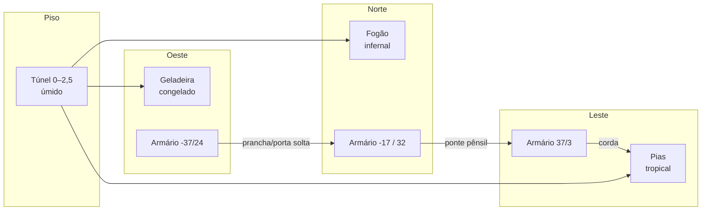

# Cozinha — Plano de Design: Interiores, Pontes e Biomas

> **Tipo:** plano/design (nada foi construído ainda). **Cena:** `Assets/Scenes/SampleScene.unity` → raiz `COZINHA`.
> **Contexto:** ação/aventura em terceira pessoa com rato. Índice: [[MOC]] · Cena: [[notes/World-Scenes]].

## 1. Como usar este documento

Cada sistema abaixo tem: **(a)** o que já existe na cena, **(b)** a proposta com medidas reais, **(c)** onde aplicar (coordenadas), **(d)** custo e critério de aceite. O roadmap do fim ordena as fases por ganho visual x esforço.

---

## 2. Raio-X do que existe hoje

Cena medida objeto por objeto (transform + bounds de malha em espaço de mundo).

### 2.1 Volumetria

| Elemento | Medida real | Observações |
|---|---|---|
| Sala | 88 × 88 (paredes internas em x/z = ±44, 2 de espessura) | **Parede sul (z = +44) não existe** — a cozinha está aberta de um lado |
| Pé-direito | chão y = 0, teto em y = 32,76 (laje `Roof` 90 × 90 × 1) | 32,7 de altura livre |
| Balcão | corpo 10 (altura) × 10,66 (largura) × 10 (prof.) — **tampo em y = 12,52**, base em y = 2,52 | 18 blocos clonados ao longo de um "U" (oeste, norte, leste) |
| Vão bancada → armário | **9,48** de altura livre (12,52 → 22,00) | A "avenida" vertical da cozinha |
| Armário superior | 10 × 10 × 10…70 (comprimento) — y de 22 a 32 | 5 blocos, todos encostados no teto (0,76 de folga) |
| Geladeira | 20 × 32 × 15,5 em (-37,16 / 15 / 5,76) | 2 prateleiras internas (y = 6 e 13), 17 blocos de gelo, **2 portas soltas** encostadas ao lado |
| Fogão | 12 × 14,25 × 16 em (15 / 6,13 / -36,48) | 4 bocas no topo (y = 13,13), 2 prateleiras internas (y = 4 e 8), forno (10 × 10,3 × 1) encostado à frente |
| Pias (2) | 10,66 × 10 × 10 em (37,56 / -5) e (37,56 / -15) | Água = bloco 9,9 × 9 × 10 (y 2,83 → 11,83): **piscina rasa nivelada com o tampo** |
| Micro-ondas | 12,6 × 5 × 12 em (32,8 / 15 / 32) | **Porta aberta + prato dentro**: hoje é o único interior legível da cena |
| Mesa + cadeiras | mesa 20 × 12,5 × 40 (tampo 11,5) no centro | 4 cadeiras (18 de altura) |
| Vassoura | 28,1 de altura em (29,78 / 23,91) | Encostada; base afunda 6,3 abaixo do chão |
| Portas de transição | 2,75 × 1 × 3,75 em (15 / 2 / -42,6) e (-42,68 / 2 / 5) | Duas saídas **no tamanho do rato**: atrás do fogão e atrás da geladeira |

### 2.2 Sistemas e materiais disponíveis

- **Luz:** 1 Directional (intensidade 2, 5000 K). **Nenhuma luz pontual/spot.**
- **Pós-processamento:** 1 `Global Volume` com Bloom, Vignette, Tonemapping, MotionBlur (`Assets/Settings/SampleSceneProfile.asset`). **Sem fog, sem exposição local.**
- **Oclusão:** SSAO está no `Assets/Settings/PC_Renderer.asset`; **não há Decal Renderer Feature**.
- **Materiais:** concreto preto/branco, Quartz/DarkQuartzo, Wood, WallWood, Roof, Floor, Iron, IronBars, Ice/BlueIce/PackedIce, Water, BlackGlass, SnowParticle. **Zero material orgânico** (musgo, terra, folha, ferrugem, fuligem, tecido, papelão).
- **Scripts reaproveitáveis:** `Pickable`/`Backpack` (itens), `WaterVolume` (**existe, mas não está usado na cena**), `Glider`, `Health`, `RatSizeProfile`.
- **Vazios:** nenhum `NavMesh` assado (`m_NavMeshData: 0`), nenhum light probe/reflection probe, nenhum `StaticEditorFlags` marcado (nada de batching), nenhum script de porta/gaveta.

### 2.3 Escala de trabalho (inferida — confirmar no editor)

Cápsula do `Player`: raio 0,16 / altura 0,80 (eixo Z), escala 1. Ou seja: **rato ≈ 0,8 un de comprimento e ~0,32 un de altura de corpo**. Isso dá **1 un ≈ 8 cm**:

| Referência | Unidades | Leitura "de rato" |
|---|---|---|
| Rato (comprimento) | 0,8 | 1 rato |
| Fresta sob o balcão | 2,52 | ~3 ratos empilhados — **já é um túnel** |
| Tampo do balcão | 12,52 | ~15 ratos da altura |
| Vão bancada→armário | 9,48 | ~12 ratos |
| Folga sobre os armários | 0,76 | cabe o rato, **não cabe a câmera** |
| Teto | 32,76 | ~40 ratos |

> Regra derivada: **1 un ≈ 1 "passo de rato"**. Toda peça nova deve ser pensada em múltiplos de 0,5–1 un.

### 2.4 Achados soltos (corrigir ao passar por essas áreas)

- 4 cadeiras: uma flutua 1,5 acima do chão em (-21,63 / 15) e as outras afundam até -1 → base inconsistente.
- 11 `Item` flutuam ~2,9 acima do tampo da mesa (y = 14,41 vs tampo 11,5).
- Vassoura: cabeça 6,3 abaixo do piso.
- `Water` das pias é só malha: **não tem `WaterVolume`** → o rato atravessa a água em vez de nadar.
- Balcões e armários são **malhas únicas e fechadas** (0 filhos): hoje é impossível abrir nada — isso define o trabalho do Sistema 1.

---

## 3. Diagnóstico de design

**Pontos fortes (não mexer):**
1. Escala já é "cozinha-colosso": 88 × 88 com bancadas de 15 ratos de altura. A fantasia de rato está resolvida.
2. Layout em "U" contínuo = circuito natural (corrida, fuga, patrulha) e leitura clara de onde ficam as coisas.
3. Os biomas já estão **latentes nos objetos**: gelo na geladeira, água na pia, fogo nas bocas, sombra sob os balcões. Não é preciso inventar geografia — é preciso **intensificar**.
4. As 2 portas de transição no tamanho do rato dão "bocas" prontas para o mundo.
5. O micro-ondas prova que interior + objeto interno já funciona visualmente.

**Lacunas (o que impede a leitura de "civilização vivendo aqui há muito tempo"):**
1. **Tudo é bloco fechado.** Sem aberturas, o olho não encontra "dentro" — e sem dentro não há história.
2. **Sem escala média.** Entre o chão e o tampo (12,5) não existe nada: falta a camada onde a vila acontece.
3. **Uma única luz.** Sem luz local, biomas não se diferenciam e os interiores ficam ilegíveis (preto chapado).
4. **Zero vegetação/sujeira.** Não há material orgânico nem decals: a "natureza retomando" não tem vocabulário.
5. **Sem tralha.** Nenhum objeto de rato (palito, barbante, rolha): falta a assinatura "construído por bichos".
6. **Sem verticalidade jogável.** Só a mesa e a vassoura permitem subir; a bancada é um penhasco de 12,5.
7. **Nada estático/batchado** e não há NavMesh: qualquer adição de props vai custar e pode travar inimigos.

**Tese do plano:** a cozinha já tem o "palco"; falta **camada de ocupação**. Três camadas narrativas, sempre na mesma ordem visual:

1. **Arquitetura** (cozinha humana, grande, dura, geométrica) — já existe.
2. **Ocupação rata** (aberturas roídas, pontes, tralha, portas entreabertas) — o grosso deste plano.
3. **Natureza retomando** (musgo, trepadeira, poeira, teias) — a cola que data tudo.

---

## 4. Princípios (válidos para todos os sistemas)

1. **Silhueta > textura.** Peças de tralha devem ser reconhecíveis em preto puro (silhueta de pregador, de clipe, de caixa).
2. **Regra do "1 terço".** Nunca abrir tudo: ~⅓ dos módulos abertos, ⅓ com marca de uso (roído/manchado), ⅓ intacto. Contraste é o que faz o abandono parecer acidental, não decorado.
3. **Tudo que é detalhe precisa de 3 níveis de leitura:** a 10 un (silhueta geral), a 2 un (rota/jogada) e a 0,5 un (texto visual: marca de dente, barbante, etiqueta).
4. **Módulo antes de peça única.** 4–6 prefabs bem feitos, repetidos e rotacionados, valem mais que 40 peças únicas.
5. **Cada bioma tem 5 assinaturas:** cor de luz, material dominante, vegetação, tralha típica e som. Sem as 5, não lê como bioma.
6. **Nada de detalhe sem colisão pensada.** O rato precisa poder entrar, subir e passar; ou o objeto é puro cenário fora de rota.

---

## 5. Sistema 1 — Armários e balcões com portas/gavetas entreabertas e interior

### 5.1 O problema técnico

`Balcao` e `Armario` são **uma malha fechada cada** (0 filhos). Não há como "abrir" sem intervir na geometria. Três caminhos:

| Caminho | Como | Prós | Contras | Recomendação |
|---|---|---|---|---|
| **A. Cirurgia no Blender** | Abrir vão no módulo, criar variantes `Balcao_Aberto`, `Armario_Aberto` com nicho interno e batente | Correto, leve, encaixa no pipeline (o projeto já usa `Assets/Models/BlenderFiles`) | Retrabalho nos 18 blocos se o UV/material for único | **Base do padrão final** |
| **B. Fachada aplicada (só Unity)** | Manter o bloco fechado e colar por fora: moldura fina + porta + "nicho" escuro recuado 0,6 | Rápido, zero Blender, funciona hoje | Precisa de cuidado para não parecer adesivo em ângulo rasante; não permite entrar de verdade | **Protótipo imediato** |
| **C. Híbrido (recomendado)** | B para validar 3 pontos na cena atual; A para produzir os 4 módulos definitivos | Aprende com o protótipo e não joga trabalho fora | Duas etapas | **Adotar** |

### 5.2 Especificação dos módulos (em unidades)

- **Batente/moldura:** 0,6 de espessura, 1,2 de largura de perfil; sobressai 0,4 do plano da fachada.
- **Porta de armário:** 1,0 de espessura, folga 0,15 em cada lado; **dobradiça no canto superior ou lateral**, não no meio.
- **Abertura "entreaberta":** 18°–32° (menos que isso lê fechado; mais que 45° vira convite óbvio). Uma porta por armário, no máximo duas.
- **Gaveta:** frente 1,0 de espessura, **puxada 25–40%** do curso (≈ 3–5 un para uma gaveta de 12). Fundo em madeira 0,3. Corrediça visível dos dois lados (2 trilhos de 0,2).
- **Interior:** nicho de **7,4 de profundidade** (bloco tem 10, parede 1,25 + fundo). Altura útil de armário: 8,4 dividida em 1 ou 2 prateleiras de 0,3. Balcão: 1 gaveta alta ou 2 meias.
- **Prateleira interna:** 0,3 de espessura, recuo 0,5 da boca (para a sombra criar profundidade).
- **Luz interna:** 1 ponto fraco (0,4 de intensidade, 3 de alcance) dentro de ⅓ dos módulos abertos — o resto fica em silhueta. Isso é o que faz o "interior" existir de longe.

### 5.3 Catálogo de fachadas (6 prefabs cobrem tudo)

1. `Fachada_PortaEntreaberta` — armário, porta 25°, interior com 1 prateleira e potes.
2. `Fachada_PortaArrancada` — porta pendurada por uma dobradiça (abandono forte), interior vazio com teia.
3. `Fachada_GavetaPuxada` — gaveta 35% fora, com tralha (garfos, tampinhas, barbante).
4. `Fachada_GavetaCaída` — gaveta fora do trilho, encostada no chão embaixo do balcão (vira **rampa** de 12,5? não: vira degrau/plataforma).
5. `Fachada_BuracoRoído` — canto do rodapé roído (0,8 de diâmetro irregular), sem porta: é a **entrada do túnel inferior**.
6. `Fachada_ModuloAbertoVazio` — módulo sem porta, com marcas de fita adesiva e um "nicho-ninho".

### 5.4 Onde aplicar (distribuição no "U")

| Zona | Módulo | Fachada | Papel |
|---|---|---|---|
| Norte, x = -25 | Balcão | Gaveta puxada | **Degrau** para a bancada (com gaveta a 5 de altura) |
| Norte, x = -15 | Balcão | Porta arrancada | Interior com tralha; acesso ao túnel |
| Norte, x = 5 | Balcão | Buraco roído | Entrada do bioma "Úmido" |
| Norte, x = 25 | Balcão | Gaveta caída + encostada | Plataforma baixa e "lixo" |
| Leste, z = 15 | Balcão | Gaveta puxada 40% | Feira/mercado (ver 8.4) |
| Leste, z = -25 (perto da pia) | Balcão | Porta arrancada | Potes, cheiro de umidade |
| Oeste, z = -15 e z = 25 | Balcão | Buraco roído + musgo | Duas bocas do túnel |
| Armário x = -17 (50 de comprimento) | Armário | 2 portas entreabertas + 1 aberta | **Vila principal no alto** |
| Armário x = 32 | Armário | Porta entreaberta | Depósito de tralha |
| Armário x = -37,25 (z = 24 e z = -17) | Armário | 1 aberta cada | Atalhos de ponte |
| Armário x = 37 (70 de comprimento) | Armário | 2 entreabertas | "Prédios" da vila leste |

Meta de cobertura: **8 aberturas de balcão + 6 de armário**, 4 buracos roídos, 6 gavetas.

### 5.5 Interior precisa de conteúdo (senão é buraco preto)

Kit mínimo de 10 props (todos entre 0,6 e 2,5 un, ou seja, "mobília de rato"):

caixa de fósforo · rolha · carretel de linha · tampinha de garrafa · pregador de roupa · clipe · palito de dente · botão · pedaço de barbante enrolado · latinha amassada.

Dentro dos módulos humanos (armário/geladeira/fogão), o conteúdo é **humano**: potes de vidro, latas, sacos de papel, cereais, formigueiro. Dentro dos nichos de rato, o conteúdo é **tralha**. Essa troca de vocabulário é o que conta a história.

### 5.6 Colisão, câmera e custo

- Nicho precisa de **colisor interno** (paredes + fundo) para o rato não atravessar; a porta entreaberta é colisor estático (sem Rigidbody — física de dobradiça só em 2–3 peças "de vitrine").
- **Câmera:** a câmera em 3ª pessoa não entra em nicho de 7,4 de profundidade → criar `CameraVolume` nos 4 nichos onde o jogador entra, puxando o offset para perto do ombro (o projeto já tem `CameraEffects`/Cinemachine).
- **Custo:** módulo aberto ≈ 200–500 tris + 1 material compartilhado. 14 aberturas + 10 props ≈ 8k tris. Irrelevante para o orçamento atual (cena tem ~90 objetos).

**Critério de aceite:** parado a 3 un de um balcão, dá para dizer o que tem dentro dele; e o rato consegue entrar em pelo menos 3 nichos.

---

## 6. Sistema 2 — Pontes e vias verticais ("as pontes do tamanho do ratinho")

### 6.1 Onde exatamente as pontes vivem

O vão livre entre tampo (12,52) e armário (22) tem **9,48 de altura** e é contínuo ao longo dos três lados — é a "avenida suspensa" perfeita: visível do chão como silhueta, inalcançável sem rota, e conecta os armários uns aos outros.

Restrição medida: **sobre os armários há só 0,76 de folga** até o teto. Cabe o rato (0,32), **não cabe a câmera**. Duas saídas:
- **(a)** Aceitar o "sótão" com câmera em modo apertado (bom para tensão, ruim para navegação longa);
- **(b) Recomendada:** rebaixar o forro em faixa ao longo do "U" (recesso/claraboia de 2,5 de profundidade) → 3,26 de folga, câmera confortável e **feixes de luz** entrando pelas frestas. Isso resolve verticalidade **e** atmosfera de abandono de uma vez.

### 6.2 Tipologias de ponte (6 prefabs + 2 de ligação)

| # | Peça | Vão | Largura | Ancoragem | Leitura |
|---|---|---|---|---|---|
| 1 | Ponte de palitos (2 palitos + travessas) | 4–6 | 0,9 | Apoiada nos batentes | Rústica, "fase 1" da vila |
| 2 | Ponte de régua | 6–9 | 1,0 | Corda amarrada nos cantos | Construída, reta, com corrimão de barbante |
| 3 | Ponte de pregadores | 3–5 | 0,8 | Presa por mola no batente | Cômica e reconhecível |
| 4 | Ponte de barbante (pênsil) | 8–12 | 0,5 (corda dupla + tábua) | Nós nos dois lados | Balança; a mais "viva" |
| 5 | Ponte de escova/cabo | 5–7 | 1,1 | Encaixada no vão | Larga, vira "praça" |
| 6 | Ponte quebrada | 4 | — | Uma ponta solta, pendurada | **Abandono**: alguém caiu ou desistiu |
| J1 | Junção 2×2 | — | 2×2 | — | Nó de encontro de 3 pontes |
| J2 | Rampa de espátula/colher de pau | 9–12 de desnível | 0,8 | Apoio no tampo + no armário | Liga bancada ↔ ponte |

### 6.3 Rotas propostas (coordenadas)

1. **Rota Norte (principal):** armário (-17,25 / 27 / -37) → ponte pênsil → armário (32 / 27 / -37). Passa em frente ao vão do fogão: a ponte "sente" o calor (barbante chamuscado perto do fogão).
2. **Rota Leste:** armário (37 / 27 / 3) → 3 pontes curtas → parede leste; desce por corda até o tampo perto da pia.
3. **Rota Oeste (gelada):** geladeira (topo 31) → prancha (uma das portas soltas da geladeira vira ponte!) → armário (-37,25 / 24). **Aproveitamento:** as 2 portas soltas já existentes são material narrativo pronto.
4. **Atalho do fogão:** rampa de espátula do tampo (12,52) até a prateleira interna do fogão (y = 8) → dentro do fogão.
5. **Subida do chão:** 3 caminhos, sem teleporte — (i) gaveta puxada como degrau, (ii) corda pendurada do armário até 6 de altura + caixa de fósforo como apoio, (iii) vassoura encostada (28) como escada natural, com barbante enrolado.
6. **Rota dos fundos:** o túnel sob os balcões (0 → 2,52) conecta os 4 buracos roídos. Iluminação mínima, mas é o caminho seguro (inimigos grandes não passam).

### 6.4 Regras de jogo

- Ponte **sempre** com 1 vão "quebrado" (peça 6) em cada rota: dá ao jogador leitura de perigo e ao cenário a marca de tempo.
- Nada de ponte onde o inimigo patrulha em NavMesh (ver 11.3): pontes são rotas do jogador, não do inimigo — isso dá valor tático à verticalidade.
- `Glider` existente deve ser a recompensa por subir: das pontes o rato planeia até a mesa/pias.

**Critério de aceite:** percorrer do chão até o topo de um armário e atravessar para outro **sem pular no vazio** e sem clipping de câmera.

---

## 7. Sistema 3 — Os Biomas

Ficha única por bioma, com as 5 assinaturas (luz, material, vegetação, tralha, som) + gameplay.

### 7.1 Tropical — as pias (leste, z = -5 e z = -15)

- **Estado atual:** piscina 9,9 × 9 × 10 nivelada ao tampo, sem `WaterVolume`.
- **Luz:** ciano-esverdeado (#7FD3C0), 2 pontos fracos + 1 spot rasante criando cáustica falsa (textura de água animada em plano no fundo).
- **Material:** reusar `Water`; adicionar `MossWet` (verde-escuro brilhante) nas bordas e `TileCracked`.
- **Vegetação:** samambaias penduradas na beirada, aguapé na água, musgo no ralo, trepadeira subindo a torneira.
- **Tralha:** doca de palitos, barquinho de casca de noz, vara de pescar com linha, redes de barbante.
- **Som:** gotejamento irregular, coaxar distante, água corrente baixa.
- **Gameplay:** ativar `WaterVolume` (1 linha de componente no trigger) para o rato nadar/mergulhar; `Submersion` já existe no `CharacterMotor`. Molhado → apaga brasa (ver 7.2).
- **Detalhe-âncora:** torneira pingando com anel de calcário no tampo (prova de anos).

### 7.2 Infernal — o fogão (norte, x = 15)

- **Estado atual:** 4 bocas (2,5–4 de diâmetro) em y = 13,13; prateleiras internas em y = 4 e 8; forno de 10 × 10,3 solto à frente.
- **Luz:** laranja (#FF7A2A) pulsante, 2 pontos dentro das bocas + 1 spot do vão do exaustor. Precisa de **flicker** (script de 12 linhas, ruído em intensidade/posição).
- **Material:** `Charcoal` (preto fosco), `Ash` (cinza claro), `Ember` (emissivo com ruído), metal com `Rust`.
- **Vegetação:** **nenhuma** — a regra é contraste: um raio de 4 un ao redor do fogão é estéril, com fuligem. Vegetação só volta a 6+ un.
- **Tralha:** panelas abandonadas, concha derretida, panela de rato (tampinha) na boca apagada, "fogueira" de rato no ladrilho.
- **Som:** estalo de brasa, zumbido de gás, panela vibrando.
- **Gameplay:** calor = dano leve em contato (usar `Health`/trigger); brasas acesas em 2 das 4 bocas; o forno aberto (10 × 10,3 de boca) é a "caverna" do bioma — interior com 3 níveis.
- **Detalhe-âncora:** a parede atrás do fogão, de x 9 a 21, escurecida em gradiente até y = 22 (fuligem subindo há décadas).

### 7.3 Congelado — a geladeira (oeste, z = 5)

- **Estado atual:** 32 de altura, 17 blocos de gelo, 2 prateleiras, 2 portas soltas, material `Quartz`.
- **Luz:** azul frio (#8FC8FF), luz interna de geladeira (uma lâmpada piscando — "ainda ligada depois de todo esse tempo" é um detalhe excelente de abandono), névoa local.
- **Material:** `Ice`, `BlueIce`, `PackedIce` já existem + `Frost` (branco leitoso) para o vidro.
- **Vegetação:** líquen escuro nas quinas, nada verde.
- **Tralha:** iglus de rato nas prateleiras, ponte de gelo entre y = 6 e y = 13, pingentes, pegadas na geada, "carne" fossilizada num pote.
- **Som:** zumbido de compressor, estalos de gelo, vento baixo.
- **Gameplay:** piso escorregadio (reduzir fricção do `CharacterMotor` dentro do volume), frio causa lentidão; o rato pode atravessar as 2 portas soltas como anteparos.
- **Detalhe-âncora:** geada avançando **2 un além** da geladeira no chão e na parede, com "língua" irregular — o bioma precisa vazar.

### 7.4 Úmido / Subsolo — embaixo dos balcões

- **Estado atual:** fresta de **2,52** sob todos os balcões (o "rodapé" já é um túnel), escura, sem nada.
- **Luz:** praticamente nenhuma — 1 cogumelo bioluminescente a cada 8–10 un (emissivo fraco), poças refletindo.
- **Material:** `MossWet`, `Puddle` (preto espelhado), `Rust` nos pés metálicos.
- **Vegetação:** musgo em 60% do rodapé, cogumelos, fetos pequenos, raízes saindo das juntas.
- **Tralha:** fios, barbantes, ninho de papel, "casas" de caixa de fósforo, túneis roídos.
- **Som:** eco de gota, roer distante, vento em fresta.
- **Gameplay:** rota segura/stealth; 4 buracos roídos como entradas; aqui a câmera precisa baixar (2,5 de teto).
- **Detalhe-âncora:** marcas de dente em semicírculo no rodapé, com serragem no chão embaixo (2 un de raio).

### 7.5 Neutro — centro (mesa, cadeiras, vassoura)

- Poeira, teias nas quinas das cadeiras, marcas de arrasto no chão, itens flutuantes corrigidos.
- Serve de "respiro" entre biomas: sem cor forte, luz branca difusa.
- A mesa (tampo 11,5) é o **ponto de orientação** central: dali se veem os 3 biomas de parede.

### 7.6 Transições (a regra que faz o conjunto parecer um lugar)

- Gradiente de **3–4 un** entre biomas: musgo morre a 4 un do fogão; geada perde força a 4 un da pia; água escorre da pia para o túnel.
- Nenhum bioma começa com linha reta — sempre irregular, seguindo juntas, quinas e ralos.
- Cada bioma tem **1 objeto-âncora** que dá a leitura de longe: anel de calcário (tropical), parede de fuligem (infernal), língua de geada (congelado), cogumelo brilhante (úmido).

Mapa mental:



---

## 8. Sistema 4 — Mini construções de tralha (a "civilização")

### 8.1 Regras de escala

| Peça | Medida | Comparação |
|---|---|---|
| Casinha | 2,0 (largura) × 1,2 (altura) × 2,5 (fundo) | 2,5 ratos de comprimento |
| Porta de casinha | 0,9 × 1,0 | Passagem confortável |
| Telhado | inclinação 35–40° | **assinatura de silhueta** |
| Fogueira | 0,8 de diâmetro | Menor que o rato |
| Ponte de casa | 0,9 | = largura das pontes |

> Tudo 2 a 3× o rato, nunca 10×: se parecer "cenário de boneca", está grande demais.

### 8.2 Kit de material (10 peças resolvem 80%)

palito de dente (viga) · caixa de fósforo (parede/casa) · rolha (assento/base) · clipe (grampo/gancho) · pregador (estrutura) · barbante (amarração/corrimão) · fita isolante (remendo) · tampinha (telhado/moeda) · papel alumínio (refletor/impermeável) · prego (pilar).

Cada peça precisa de **2 variantes gastas** (torto, mordido) para não repetir.

### 8.3 Os 6 assentamentos

| # | Nome | Local (coords) | O que conta | Função de jogo |
|---|---|---|---|---|
| 1 | **Vila do Vão** | armário x = -17 (50 de comprimento), y 22–32 | 7 casinhas em duas fileiras, escada de garfo, "praça" na frente da porta entreaberta | Hub visual principal, visto do chão como silhueta pontuda |
| 2 | **Porto da Pia** | borda da pia z = -5, y 12,5 | doca de palitos, 2 barquinhos, vara de pescar, redes | Ponto de "pesca" (item), ensina natação |
| 3 | **Forte de Gelo** | dentro da geladeira, prateleiras y = 6 e 13 | 4 iglus, ponte de gelo entre prateleiras, "muralha" de gelo quebrada | Abrigo (sem dano de frio) |
| 4 | **Forja do Forno** | interior do forno (10 × 10,3) e prateleira y = 8 | bigorna de botão, martelo de prego, fogueira de rato, panela-tampinha | Craft/upgrade (gancho futuro) |
| 5 | **Feira da Gaveta** | gaveta puxada do balcão leste z = 15 | barracas de fósforo, tampinhas como moeda, "balança" de clipe | Comércio/narrativa (gancho) |
| 6 | **Vigia da Mesa** | tampo da mesa (11,5) e cadeira (-11 / 5) | torre de carretel, escada de garfo, "bandeira" de barbante | Ponto de vista / mapa do minimapa |

Extra barato e de alto impacto: **"marcas de gerações"** — riscos de altura na parede perto da vila (1 risco por geração), uma casinha **em construção** (palitos sem telhado), e uma **abandonada** (telhado caído). Isso data a ocupação sem precisar de texto.

### 8.4 Sinais de vida (o que faz parecer habitado, não decorado)

- Fumaça fina em 2 chaminés (partícula, não luz).
- 3 luzes acesas (as demais apagadas) — contraste de "alguns ainda vivem aqui".
- Pegadas e trilhas desgastadas no pó ligando os assentamentos.
- "Fiação" de barbante entre casas (poste de prego).
- Estoque: montinhos de sementes/tampinhas empilhados.
- Um "ninho" abandonado com um objeto pessoal (botão azul).

**Critério de aceite:** visto de qualquer canto do chão, pelo menos 2 assentamentos são reconhecíveis como "feitos por alguém".

---

## 9. Sistema 5 — Estética abandonada e vegetação

### 9.1 Vocabulário vegetal (6 prefabs + 2 materiais)

Não existe nenhum asset orgânico hoje. Proposta: 6 prefabs low-poly no Blender (o projeto já usa `.blend` para rato/prego/palito):

1. `Musgo_Patch` — mancha irregular (quad deformado, 3 tamanhos), `MossWet` e `MossDry`.
2. `Feto_Pequeno` — 5–7 frondes (2 triângulos cada), 1,2–2,5 un de altura.
3. `Trepadeira` — módulo de 4 un com ganchos, empilhável até 12 (sobe parede).
4. `Grama_Tufo` — 4–6 lâminas, 0,6–1,2 un; aparece em rachaduras.
5. `Cogumelo` — 3 variantes, 1 emissiva (`Glow`).
6. `Raiz_Aérea` — fita fina pendurada, vem do teto/vão.

Materiais: `MossWet`, `MossDry`, `Foliage` (2-sided, alpha cutout), `Glow` (emissivo), `Rust`, `Ash`, `Charcoal`, `Frost`, `Cardboard`, `Fabric`.

### 9.2 Regra de distribuição (umidade = vegetação)

| Local | Densidade | O que cresce |
|---|---|---|
| Borda da pia e ralo | alta | musgo molhado, feto, aguapé, trepadeira na torneira |
| Túnel sob balcões | alta (mas escura) | musgo, cogumelo brilhante, raiz |
| Juntas de parede e quinas | média | trepadeira, musgo seco, grama em rachadura |
| Paredes longe da água | baixa | musgo seco em mancha, poeira |
| Raio de 4 un do fogão | **zero verde** | fuligem, ash, teia queimada |
| Geladeira (interior) | zero verde | líquen escuro, gelo |
| Sul aberto (z = +44) | alta | o "lado de fora" tomado: trepadeiras descendo do teto, grama no piso |

### 9.3 Sujeira e "tempo" (a cola de tudo)

- **Poeira:** 1 material com máscara nas superfícies horizontais (tampo, mesa, topo de armário) + partículas de poeira no ar (barato, 200 partículas).
- **Teias:** 6 quads triangulares nas quinas altas; sempre em quina, nunca no meio.
- **Marcas de água:** anéis de calcário embaixo de cada ponto de gotejamento.
- **Rachaduras:** 4 quads/texturas no piso ligando rachadura → grama.
- **Ferrugem:** borda inferior dos balcões metálicos e pés do fogão.
- **Mordidas:** semicírculos no rodapé, nas quinas das portas, nas caixas.
- **Decals:** o `PC_Renderer` **não tem** a feature de Decal. Duas opções: (i) adicionar `DecalRendererFeature` (1 clique, custo baixo no PC; checar `Mobile_RPAsset` depois) — melhor para manchas; (ii) malhas finas apoiadas (0,02 acima da superfície) — zero configuração. Recomendo (ii) para o piso e (i) só se quiser mancha orgânica irregular.

**Critério de aceite:** cobrir a metade esquerda da tela e ainda assim saber em qual bioma o jogador está.

---

## 10. Sistema 6 — Luz e atmosfera

### 10.1 Orçamento e estratégia

Hoje: 1 luz direcional, sem probes, sem fog. Proposta realista:

| Camada | Quantidade | Sombra | Uso |
|---|---|---|---|
| Directional | 1 | sim | sol pelas frestas do forro rebaixado (7.1b) |
| Point/Spot por bioma | 3–4 por bioma (≈ 14) | só 4 com sombra | fogo, geladeira, pia, cogumelos |
| Emissivo sem luz | livre | não | brasas, cogumelo, lâmpada da geladeira |
| `Global Volume` local | 4 (um por bioma) | — | fog + grade + exposição, com blend distance 4 |

- **Fog:** ativar Fog no volume local (não global) — tropical: raso e esverdeado; infernal: quente e denso embaixo; congelado: azul e espesso; úmido: quase sem fog, só escuro.
- **Feixes de luz (god rays):** URP não tem volumétrico nativo → usar 3–5 quads com material aditivo em cone (barato) entrando pela claraboia; a poeira em partículas vende o resto.
- **Probes:** 1 `LightProbeGroup` por bioma (a cena não tem nenhum) e 1 Reflection Probe na pia (a água reflete).
- **Flicker:** um único script `LightFlicker` (ruído + envelope) em fogo e na lâmpada da geladeira. É o efeito de maior impacto por linha de código do plano.

### 10.2 Tabela de biomas

| Bioma | Luz (cor / intensidade / alcance) | Fog | Emissivo | Som |
|---|---|---|---|---|
| Tropical | #7FD3C0 / 3 / 14 | raso, verde | água, cogumelo | gotejamento, coaxar |
| Infernal | #FF7A2A / 5 / 12 + flicker | quente, baixo | brasa | estalo, zumbido |
| Congelado | #8FC8FF / 4 / 16 | azul, denso | lâmpada piscando | compressor, gelo |
| Úmido | #6A7A5A / 1 / 6 | quase zero | cogumelo | gota, roer |
| Neutro | branco / 2 / 20 | zero | — | vento distante |

---

## 11. Organização, produção e riscos

### 11.1 Hierarquia-alvo

```
COZINHA
├─ Arquitetura      (paredes, piso, teto, forro rebaixado)
├─ Eletrodomesticos (geladeira, fogao, forno, microondas, pias)
├─ Moveis           (balcoes, armarios, mesa, cadeiras, vassoura)
│   └─ Balcao_B1 … Balcao_B14  (module + Fachada_*)
├─ Biomas
│   ├─ Tropical / Infernal / Congelado / Umido
├─ Assentamentos    (Vila_01 … Vila_06)
├─ Pontes           (Ponte_01 …)
├─ Vegetacao        (Musgo_*, Feto_*, Trepadeira_*)
├─ Iluminacao       (Luz_*, Volumes)
└─ Volumes          (BiomeTrigger, CameraVolume)
```

Convenções: prefixo por sistema (`Ponte_`, `Fachada_`, `Vila_`, `Musgo_`), pivô sempre na base-centro, escala 1.

### 11.2 Assets a criar

- **Blender:** `Balcao_Aberto`, `Armario_Aberto`, `Fachada_Kit` (6), `Ponte_Kit` (6+2), `Tralha_Kit` (10 × 2 variantes), `Planta_Kit` (6).
- **Materiais:** 10 novos (lista em 9.1).
- **Scripts novos (mínimos):** `LightFlicker`, `BiomeZone` (trigger → aplica volume + som), `CameraVolume`. Nada de novo sistema de interação: portas/gavetas são estáticas.

### 11.3 Riscos medidos

| Risco | Efeito | Mitigação |
|---|---|---|
| **NavMesh não assado** | inimigos não andam direito assim que houver props | assar depois de cada fase; props de detalhe fora de rota ou em layer ignorada |
| **Câmera em espaço apertado** (nicho 7,4; túnel 2,5; sótão 0,76) | clipping/náusea | `CameraVolume` com offset curto + near plane pequeno |
| **Sem batching** (0 objetos static) | draw calls sobem com 300 props | marcar `Static` em cenário; material atlas por kit; LOD só nas plantas |
| **Uma luz só + interiores** | interiores viram preto chapado | luzes/cogumelos emissivos dentro dos nichos (5.2) |
| **Pia sem `WaterVolume`** | rato atravessa água | adicionar o componente existente no trigger do `Water` |
| **Ponha tudo aberto** | perde o abandono (vira casa de boneca) | regra do ⅓ (4.2) |
| **Escala do teto** | sótão sem câmera | forro rebaixado (6.1b) |
| **Sul sem parede** | "cozinha" perde fechamento | decidir: fechar parcialmente (parede quebrada + entulho) ou assumir como "quintal" tomado por vegetação |

---

## 12. Roadmap (fases testáveis)

| Fase | Entrega | Ganho | Esforço | Aceite |
|---|---|---|---|---|
| **0 — Base** | Reorganizar hierarquia; marcar static; assar NavMesh; corrigir 4 objetos fora de prumo; adicionar `WaterVolume` nas pias; `LightFlicker` | Mapa de trabalho limpo | 1 sessão | Cena roda igual, nada flutuando |
| **1 — Interiores** | `Fachada_*` (protótipo "aplicado") em 3 balcões + 1 armário; `Tralha_Kit` v1; luz interna | **O salto de leitura maior de todos** | 2–3 sessões | "Dá para ver dentro" de 3 móveis |

> **Status:** protótipo da Fase 1 **executado na cena** em 2026-11-18 (2 balcões + 1 armário). Ver §13 para o que existe, as diferenças em relação às medidas originais e o que falta para fechar a fase.
| **2 — Verticais** | Forro rebaixado no "U"; 6 pontes + 2 rampas; subida do chão (3 rotas) | Transforma o mapa em 3D jogável | 3 sessões | Chao → armário → armário a pé |
| **3 — Assentamentos** | 3 vilas (Vão, Porto, Forte) + sinais de vida | Conta a história | 3 sessões | 2 vilas legíveis do chão |
| **4 — Biomas** | 4 volumes + luzes + fog + emissivos + âncoras de bioma | Diferencia áreas | 3 sessões | Reconhecer bioma com metade da tela coberta |
| **5 — Natureza** | Plantas, musgo, teias, poeira, mordidas, decals | Data o abandono | 2–3 sessões | Manchas irregulares, nada "limpo" |
| **6 — Polimento** | 3 vilas restantes, ponte quebrada, partículas, som, LOD | Fecha | 2 sessões | Passeio completo sem clipping |

> Se for para fazer **só uma coisa**: Fase 1. Aberturas com interior mudam a leitura da cena mais do que qualquer outro item.

---

## 13. Estado de execução — protótipo Fase 1 (2026-11-18)

> Esta seção foi escrita depois das 1–12: é o registro do que já está na cena.

Construído na cena como **fachada aplicada com primitivas** (caminho B do §5.1), dentro de `/COZINHA/Prototipo_Aberturas`. O grupo raiz fica em local `(0, -7,52, 0)` para que **local = mundo** em todos os filhos (facilita o ajuste fino).

| Grupo | Objeto | O que tem | Medidas aplicadas |
|---|---|---|---|
| `B1_Gaveta_x-25` | balcão norte x = -25 | gaveta puxada com fundo, laterais, trilhos e puxador + 10 props de tralha | frente 6,62 × 2,9; puxada **4,0** (≈35%); interior 6,0 × 4,15; trilhos 0,2 |
| `B2_PortaArrancada_x-15` | balcão norte x = -15 | nicho 6,4 × 6,6 + batente 0,7 + prateleira + porta entreaberta **28°** + porta arrancada encostada + 8 props | nicho 1,7 de profundidade aplicada; batente 0,6 |
| `A1_Portas_x-17` | armário (-17,25 / 27 / -37) | cavidade 12,5 × 7,0 em 3 bays (2 montantes), 3 prateleiras, 2 portas entreabertas (**25°** e **20°**), 1 porta solta, 11 props | vão 2,1 de profundidade aplicada; prateleiras 0,3 |

Totais: **63 malhas + 4 luzes** (1 em cada balcão, 2 no armário), luz quente `1 / 0,82 / 0,58`, intensidade **0,4**, alcance **3**, sombras desligadas (nota §5.2).

Materiais reaproveitados: `BlackConcrete` (interior), `Wood` (batente/porta/gaveta/props de madeira), `Iron` (metais, trilhos, dobradiças, latas), `Quartz` (botão/pote).

### Diferenças conhecidas em relação à spec

- **Profundidade do nicho:** 1,7–2,1 (aplicada) contra 7,4 previstos para o módulo do Blender. É o limite do caminho B — não dá para entrar, só olhar. Fecha na conversão para módulo real.
- **Sem material próprio** de interior/tralha (o gate de comandos destrutivos do editor bloqueou `asset create`/`material set_properties`). O contraste vem dos materiais existentes + luz interna.
- **Sem `LightFlicker`** (é item da Fase 0) e sem prefabs (`prefab create` também não rodou): as peças estão como objetos de cena, prontas para virar `Fachada_*` quando o Blender entrar.
- **Colisão:** as primitivas mantêm seus colisores, então a fachada é sólida (bate-se nela). Nicho não é navegável nesta versão.
- **Não verificado visualmente:** captura de Scene/Game view exige comando destrutivo. A conferência foi numérica (hierarquia, transforms, materiais, luz).

### Para fechar a Fase 1

1. Olhar a cena e ajustar: intensidade das luzes (0,4 → 1,0 se estiver escuro demais), ângulo das portas e o quanto a gaveta sai.
2. Criar `InteriorDark` + 3 materiais de tralha e trocar os provisórios.
3. Converter os três grupos em prefabs `Fachada_GavetaPuxada`, `Fachada_PortaArrancada`, `Fachada_PortaEntreaberta`.
4. Aplicar nos pontos restantes da tabela §5.4 (8 balcões + 6 armários).

## 14. Ganchos extras (para depois, não agora)

- Água molha o rato → apaga brasa → abre passagem no fogão (bioma ↔ bioma).
- Gelo escorregadio + `Glider` = atalhos aéreos.
- Formigas como segunda facção disputando a feira.
- Minimapa (`Minimap` já existe) com tint por bioma.
- "Diário" de gerações: 3 riscos de altura na parede contam a cronologia sem texto.
