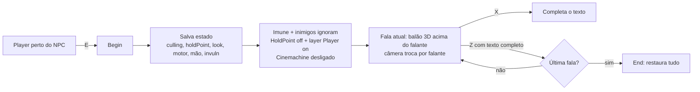

# Diálogos com NPC — plano e estado atual

> Sistema de conversa com NPCs: marcador "!" + aura, interação por tecla, câmera cinematográfica que alterna quem fala, texto 3D com máquina de escrever e bloqueio total do jogador durante a conversa.
> Relaciona: [[notes/Player]] · [[notes/Enemy]] · [[notes/World-Scenes]] · [[architecture/Overview]] · Índice: [[MOC]]

## Ideia original (pedido)

1. NPCs marcados com **"!" na cabeça** e **aura ao redor** indicando importância.
2. Perto do NPC, uma tecla inicia a conversa; o NPC **vira para o jogador**.
3. A câmera **sai da primeira pessoa** e alterna enquadramento conforme quem fala.
4. Conversa **totalmente editável**: quem fala + o que fala.
5. Texto **3D acima de quem fala**, letra por letra (máquina de escrever).
6. **Z** avança quando o texto termina; **X** completa o texto na hora.
7. Durante o diálogo: jogador **imune a dano** e **ignorado pelos inimigos**.
8. **HoldPoint desaparece** por completo.
9. Câmera passa a **mostrar a layer Player** (normalmente escondida).
10. No fim, **tudo volta ao normal**.

## Arquitetura (atual)

| Arquivo | Papel |
|---|---|
| `DialogueLine.cs` | `DialogueSpeaker { Npc, Player }` + `DialogueLine { speaker, text }` (serializável, editado no Inspector). |
| `NpcDialogue.cs` | Marcador "!", aura, prompt `[E] Falar`, alcance, tecla configurável, lista de falas e rotação para encarar o jogador. |
| `DialogueDirector.cs` | Máquina de estados da conversa: salva/restaura estado do jogador, controla câmera, digitação e teclas Z/X. Criado automaticamente na cena. |
| `DialogueBubble.cs` | Balão world-space (Canvas + TMP) com nome do falante, corpo do texto e dica `[Z]`. |
| `DialogueFont.cs` | Fonte TMP padrão e texto 3D simples (marcador/prompt). |
| `EnemyNavmesh.cs` | Passa a ignorar o jogador quando `DialogueDirector.PlayerBusy` (visão e audição). |

Fluxo:

## Como autorar uma conversa

No GameObject do NPC, componente **Npc Dialogue**:

- **Identidade → Display Name**: nome mostrado no balão (ex.: `Rato Ancião`).
- **Conversa → Lines**: adicione falas; em cada uma escolha **Speaker** (`Npc` / `Player`) e escreva o texto.
- **Interação**: `Interact Key` (padrão `E`), `Interact Range` (padrão `2.5`) e o rótulo do prompt.
- **Marcadores**: liga/desliga, texto (`!`), cor do marcador e cor/alpha da aura.

O balão, o marcador e a aura são criados em runtime; nada precisa ser montado na mão.

## Câmera

- Cinemachine é desligado no início e religado no fim (mesmo caminho de `PlayerDeathSequence`).
- Enquadramento "por cima do ombro" do **ouvinte**, olhando o **falante**; o lado do ombro alterna entre NPC e jogador.
- Altura usa os bounds do renderer (o NPC tem 0.44 de altura; o jogador é um rato pequeno).
- `Physics.Linecast` puxa a câmera para perto se houver parede/móvel entre ela e o falante.

## Testes realizados (2026-11-26, Play Mode via Code Mode)

Cobaia: GameObject **NPC** (`Assets/Scenes/SampleScene.unity`), com `NpcDialogue` adicionado e cena salva.

- E abre a conversa (prompt em alcance) — verificado.
- NPC gira para o jogador — verificado (`npcForward` passa a apontar para o player).
- `HoldPoint` desativado, `cullingMask` 183 → 191 (layer Player visível), motor travado, imune a dano (20 → 20) — verificado.
- Câmera sai da primeira pessoa e troca de lado ao mudar o falante (NPC → jogador) — verificado por posição/rotação e captura do Game view.
- Máquina de escrever revela parcial (29/53), **X** completa (53/53) e mostra a dica `[Z]` — verificado.
- **Z** avança e encerra na última fala — verificado.
- Inimigo via o jogador antes (`canSee = true`, `Chase`) e deixa de ver durante a conversa (`canSee = false`) — verificado chamando a varredura de visão.
- Fim da conversa restaura: primeira pessoa, `HoldPoint` ativo, culling 183, motor liberado, balão escondido, marcadores/aura de volta — verificado.

Limitação do teste: `runtime simulate_key` do pipeline não entrega `wasPressedThisFrame` ao jogo; as teclas foram injetadas pelo próprio Input System (`QueueStateEvent`) e o `Update` do componente foi chamado no mesmo frame do evento. O caminho de tecla do jogador é o real; só a origem do evento foi sintética.

## Pendências / próximos passos

- O NPC da cena está em `(-81.3, 0.5, 37.7)`, **fora do piso da cozinha** — os testes moveram o NPC para perto do jogador apenas em Play Mode. Falta posicioná-lo em uma área jogável.
- Crosshair da UI continua visível durante a conversa (é HUD de mira); avaliar esconder junto com o `HoldPoint`.
- Sem retratos/emoção por fala; o modelo atual é fala + falante.
- Sem opções de resposta do jogador (diálogo linear).
