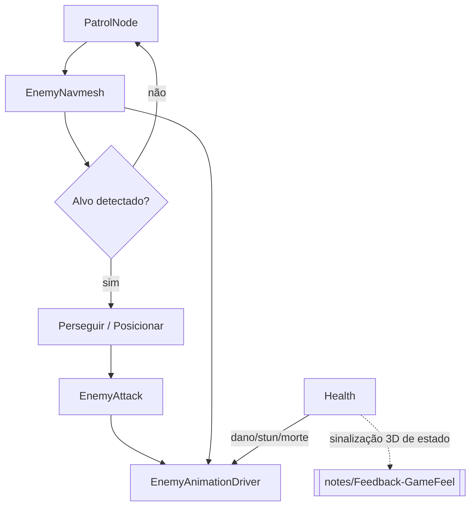

# Enemy

Comportamento, navegação e combate de inimigos. Índice: [[MOC]] | Contratos: [[architecture/Contract-Map]].

## Componentes principais (`Assets/Scripts/Enemy/`)

- `EnemyNavmesh.cs` — movimentação/navegação (NavMesh) e patrulha/perseguição.
- `EnemyAttack.cs` — lógica de ataque (modos conforme item: melee `ISwingWeapon`, ranged `IUsable`; eventos compatíveis com animação).
- `EnemyAnimationDriver.cs` — animações do inimigo.
- `Assets/Scripts/PatrolNode.cs` — pontos/rotas de patrulha.
- `Assets/Scripts/Health.cs` — vida, dano, stun e morte (`IDamageable`, `IHealth`, eventos).

## Estado e sinalização (aprovado)
- **Sinalização 3D de dano/estado** deve comunicar acertos, vida baixa/estado crítico e morte também para inimigos, de forma legível no mundo 3D (ver [[notes/Feedback-GameFeel]], [[architecture/Decisions/ADR-0003-feedback-world-space]]).
- Telegráficos/estados de percepção (suspeita, busca, perseguição) são evoluções naturais do domínio; registrar decisões em [[architecture/Decisions/README]] quando definidas.

## Relações
- Interage com o jogador (dano/ameaça): [[notes/Player]].
- Usa contratos/enums compartilhados: [[architecture/Overview]], [[architecture/Contract-Map]] (`IDamageable`, `IHealth`, `IUsable`, `IPickable`, etc.).
- Atua em cenas e navegação: [[notes/World-Scenes]].
- Validação e observações: [[notes/Playtest-Log]], [[architecture/Unity-MCP-Connection]].

## Fluxo (alto nível)

