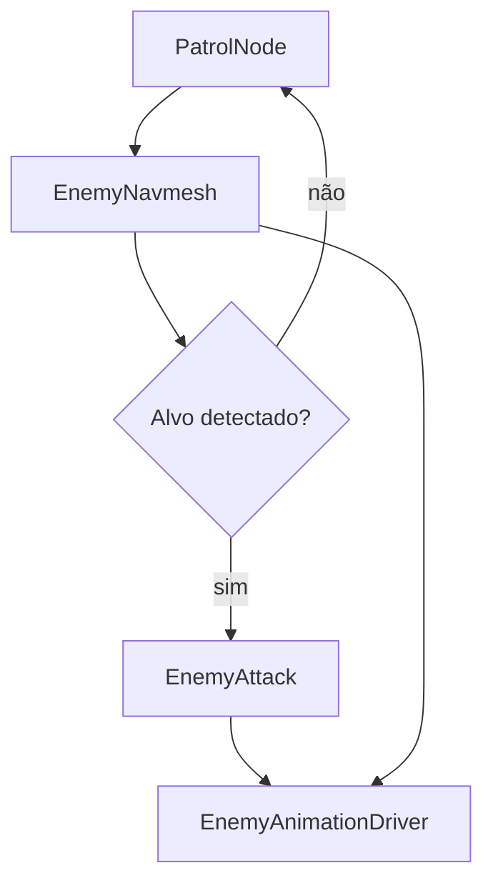

# Enemy

Comportamento e navegação de inimigos.

## Componentes principais (`Assets/Scripts/Enemy/`)

- `EnemyNavmesh.cs` — movimentação/navegação (NavMesh).
- `EnemyAttack.cs` — lógica de ataque.
- `EnemyAnimationDriver.cs` — animações do inimigo.
- `Assets/Scripts/PatrolNode.cs` — pontos de patrulha/rotas.

## Relações

- Interage com o jogador ([[notes/Player]], ex.: `Health`).
- Opera dentro das cenas e navegação do mundo ([[notes/World-Scenes]]).
- Usa tipos/contratos compartilhados em [[architecture/Overview]].

## Fluxo (alto nível)

