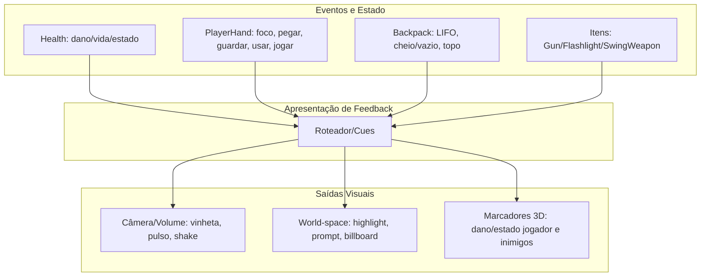

# Feedback & Game Feel

Nota conceitual sobre legibilidade, resposta visual e sensação de controle no **ProjetoAction**. Diretriz principal: [[architecture/Decisions/ADR-0003-feedback-world-space]]. Índice: [[MOC]].

## Objetivos
- Tornar **estado e consequências** claros no espaço 3D (imersão de rato).
- Dar resposta imediata a ações (sucesso e falha) e comunicar risco (vida baixa, perigo).
- Suportar a mecânica de **sacola LIFO** com boa legibilidade (ver [[architecture/Decisions/ADR-0001-inventario-sacola-lifo]], [[notes/Inventory]]).

## Pilares

### 1. Vida baixa e dano (câmera + mundo 3D)
- **Jogador:** feedback progressivo conforme % de vida (ex.: vinheta/pulso/ajuste de cor via volume/câmera, shake/impulso leve), removido ao curar/sair do limiar/morrer/resetar.
- **Sinalização 3D de dano/estado (jogador e inimigos):** flash/tint, pulso ou marcador temporário ao receber dano; indicação de estado crítico quando aplicável.
- **Fontes atuais:** `Assets/Scripts/Health.cs` (eventos `Damaged`, `HealthChanged`, `Died`, `StunChanged`), `Assets/Scripts/CameraEffects.cs`, `Assets/Settings/DefaultVolumeProfile.asset`.
- **Estado:** direção aprovada; componentes de feedback dedicados podem estar planejados/em integração incremental.

### 2. Feedback ao usar item (sucesso e falha)
- **Arma (`Gun`):** disparo (flash/recuo/traço conforme disponível), clique vazio/sem munição, recarga em progresso e conclusão.
- **Lanterna (`Flashlight`):** toggle on/off claramente percebido.
- **Melee (`SwingWeapon`):** execução do golpe (janela/trail/impacto) e resultado.
- **Geral:** falhas relevantes (`UseResult`: `Empty`, `Cooldown`, `Blocked`, `NoTarget`, `Failed`) devem ter resposta distinguível de sucesso.
- **Vocabulário:** `UseResult`, `FeedbackCue` em `Assets/Scripts/Enuns.cs` (ver [[architecture/Contract-Map]], [[architecture/Decisions/ADR-0004-contratos-evolucao-compativel]]).

### 3. Informação visual no mundo 3D (interação e inventário)
- **Foco/highlight:** interagível/pickable no alcance e sob mira destacado.
- **Prompt contextual world-space:** ação possível e estado (ex.: pegar, sacola cheia, recarregar) em billboard/marcador.
- **Ações de inventário:** guardar, recuperar (topo LIFO), jogar — com pistas claras de resultado e quantidade/topo quando útil.
- **Interação pela boca:** 1 item ativo por vez (ver [[architecture/Decisions/ADR-0002-interacao-boca-um-item]]).

## Diretrizes de implementação
- Priorizar **world-space/billboard + cena/câmera**; HUD 2D mínimo/trivial.
- **Placeholders visuais simples** são aceitáveis para validar legibilidade e timing.
- Preferir reagir a **eventos/contratos** (Health, PlayerHand/itens, inventário) para desacoplar lógica e apresentação.
- Manter hierarquia visual: foco do jogador > feedback imediato da ação > estado persistente/ambiental.

## Fluxo (conceitual)

## Validação
- Registrar observações e ajustes em [[notes/Playtest-Log]].
- Exercitar no Play Mode com editor conectado: [[architecture/Unity-MCP-Connection]].
- Relacionar mudanças de contratos/integração a [[architecture/Contract-Map]] e ADRs.