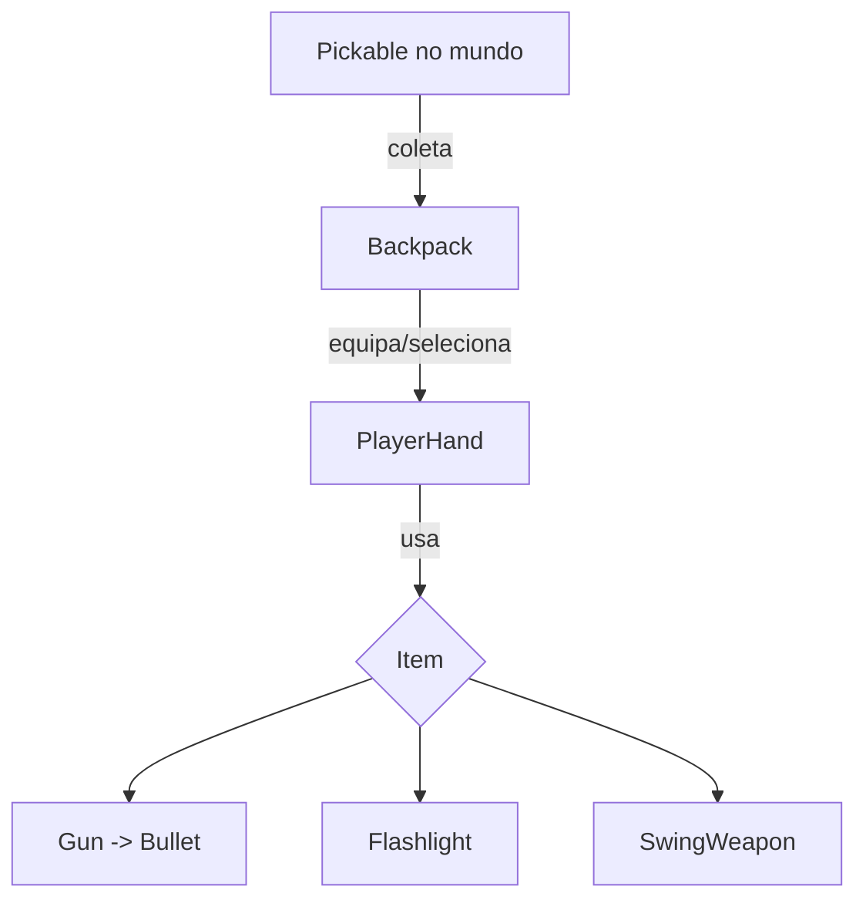

# Inventory

Sistema de inventário, coleta e itens utilizáveis.

## Componentes principais

- `Assets/Scripts/Backpack.cs` — lógica de mochila/inventário.
- `Assets/Scripts/Pickable.cs` — itens coletáveis no mundo.
- `Assets/Scripts/Itens/Bullet.cs` — projétil/munição.
- `Assets/Scripts/Itens/Flashlight.cs` — lanterna.
- `Assets/Scripts/Itens/Gun.cs` — arma de fogo.
- `Assets/Scripts/Itens/SwingWeapon.cs` — arma de ataque corpo a corpo/balanço.

## Relações

- Conectado ao jogador via `PlayerHand` em [[notes/Player]].
- Depende de contratos/tipos em [[architecture/Overview]].
- Itens e pickables são posicionados em cenas/prefabs ([[notes/World-Scenes]]).

## Fluxo (alto nível)

