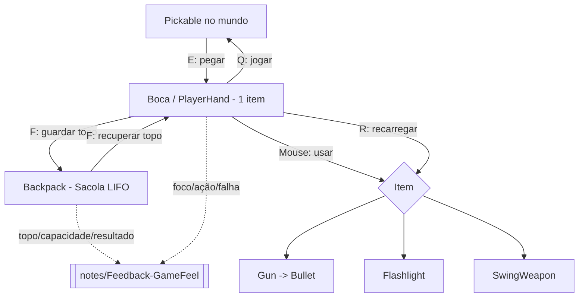

# Inventory

Sistema de **sacola** (inventário), coleta e itens utilizáveis. Índice: [[MOC]] | Contratos: [[architecture/Contract-Map]].

## Decisão central: sacola LIFO (tensão cômica)
- **LIFO (Last-In, First-Out):** o último item guardado fica no **topo** e é o primeiro a ser recuperado.
- Mecânica intencional: item valioso guardado cedo pode ir para o fundo, exigindo descartar/gerenciar itens do topo para acessá-lo — criando tensão leve e cômica.
- LIFO é o comportamento/view padrão de recuperar (ver [[architecture/Decisions/ADR-0001-inventario-sacola-lifo]], [[notes/Glossary]]).

## Interação (boca, 1 item por vez)
- O jogador pega/segura itens com a **boca** (1 item ativo). Guardar libera a boca; recuperar pega o topo da sacola.
- Semântica de design vs nomenclatura de código (`PlayerHand`/`holdPoint`): [[architecture/Decisions/ADR-0002-interacao-boca-um-item]].

## Fluxo atual (baseline)
- **Pegar (E):** raycast no alcance coleta `IPickable` para a boca (`PlayerHand` → `Pickable.PickUp`).
- **Guardar (F, com item na boca):** `Backpack.TryStore` solta/desativa e empilha no topo (se houver espaço).
- **Recuperar (F, boca livre):** `Backpack.TryRetrieve` remove/reativa o topo e coloca na boca.
- **Usar:** mouse (primário) aciona `IUsable`; **Recarregar (R):** `IReloadable` quando aplicável; **Jogar (Q):** solta com força.
- **Capacidade:** sacola com limite (`capacity`); operações falham se cheia/vazia.

## Componentes principais

- `Assets/Scripts/Backpack.cs` — sacola LIFO (`Stack<IPickable>`), `TryStore`, `TryRetrieve`, `Count/IsFull`.
- `Assets/Scripts/Pickable.cs` — item coletável/segurável (`IPickable`, `IHoldListener`).
- `Assets/Scripts/PlayerHand.cs` — orquestra interação, boca e uso.
- `Assets/Scripts/Itens/Gun.cs` — arma (`IUsable`, `IReloadable`), pool de balas.
- `Assets/Scripts/Itens/Bullet.cs` — projétil/dano.
- `Assets/Scripts/Itens/Flashlight.cs` — lanterna (`IUsable`, toggle).
- `Assets/Scripts/Itens/SwingWeapon.cs` — arma melee (`IUsable`, `ISwingWeapon`).

## Feedback e legibilidade (aprovado/planejado)
- Indicar foco/alvo interagível, resultado de pegar/guardar/recuperar/jogar, sacola cheia/vazia e topo/contexto LIFO no **world-space/cena/câmera** (HUD 2D mínimo).
- Sinalizar uso com sucesso/falha (ex.: sem munição, recarregando, toggle) de forma distinguível.
- Vocabulário e evolução compatível: `UseResult`, `ItemCategory`, `FeedbackCue` em `Enuns.cs`; ver [[notes/Feedback-GameFeel]], [[architecture/Decisions/ADR-0003-feedback-world-space]], [[architecture/Decisions/ADR-0004-contratos-evolucao-compativel]].

## Relações
- Jogador (boca/input/animação): [[notes/Player]].
- Contratos e estado de evolução: [[architecture/Contract-Map]], [[architecture/Overview]].
- Posicionamento em cena/prefabs: [[notes/World-Scenes]].
- Validação de fluxo e legibilidade: [[notes/Playtest-Log]].

## Fluxo (alto nível)

