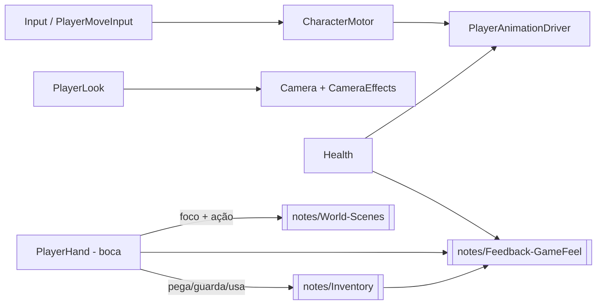

# Player

Sistemas que controlam o personagem jogável (rato). Índice: [[MOC]] | Contratos: [[architecture/Contract-Map]].

## Semântica de interação
- O jogador pega e segura itens com a **boca** (1 item ativo por vez), mesmo que no código apareça como “mão/hand” (`PlayerHand`, `holdPoint`). Ver [[architecture/Decisions/ADR-0002-interacao-boca-um-item]] e [[notes/Glossary]].
- Inventário em sacola **LIFO**: guardar libera a boca; recuperar devolve o topo da sacola (ver [[notes/Inventory]], [[architecture/Decisions/ADR-0001-inventario-sacola-lifo]]).

## Componentes principais

- `Assets/Scripts/CharacterMotor.cs` — movimento do personagem.
- `Assets/Scripts/PlayerMoveInput.cs` — leitura de entrada (Input System).
- `Assets/Scripts/PlayerLook.cs` — controle de câmera/olhar.
- `Assets/Scripts/PlayerHand.cs` — foco/interação, pegar (E), usar (mouse), recarregar (R), guardar/recuperar topo (F), arremessar (Q).
- `Assets/Scripts/PlayerAnimationDriver.cs` — animações do jogador.
- `Assets/Scripts/CameraEffects.cs` — efeitos de câmera (bob, impacto; base para feedback).
- `Assets/Scripts/RatSizeProfile.cs` — perfil/tamanho (escala/comportamento, `RatSize`).
- `Assets/Scripts/Health.cs` — vida/estado vital (`IDamageable`, `IHealth`, eventos de dano/vida/morte/stun).

## Feedback e legibilidade (jogador)
- **Vida baixa/dano:** feedback progressivo em câmera/cena e sinalização 3D conforme estado (ver [[notes/Feedback-GameFeel]], [[architecture/Decisions/ADR-0003-feedback-world-space]]).
- **Uso de item:** resposta para sucesso e falhas (vazio, cooldown, bloqueio) e estados como recarga/toggle.
- **Interação no mundo 3D:** indicação de alvo focado e prompt contextual; HUD 2D mínimo/trivial.
- Estado de implementação pode ser incremental; consultar [[architecture/Contract-Map]] (atual vs planejado).

## Relações
- Contratos/enums compartilhados: [[architecture/Overview]], [[architecture/Contract-Map]] (`Contracts.cs`, `Enuns.cs`).
- Inventário e itens: [[notes/Inventory]].
- Inimigos e dano/estado: [[notes/Enemy]].
- Cena e integração: [[notes/World-Scenes]].
- Validação: [[notes/Playtest-Log]], [[architecture/Unity-CodeMode-Connection]].

## Fluxo (alto nível)

