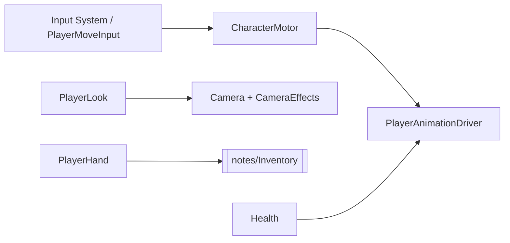

# Player

Sistemas que controlam o personagem jogável.

## Componentes principais

- `Assets/Scripts/CharacterMotor.cs` — motor de movimento do personagem.
- `Assets/Scripts/PlayerMoveInput.cs` — leitura de entrada de movimento (Input System).
- `Assets/Scripts/PlayerLook.cs` — controle de câmera/olhar.
- `Assets/Scripts/PlayerHand.cs` — interação/uso de itens na mão.
- `Assets/Scripts/PlayerAnimationDriver.cs` — condução de animações do jogador.
- `Assets/Scripts/CameraEffects.cs` — efeitos de câmera.
- `Assets/Scripts/RatSizeProfile.cs` — perfil/tamanho (variação de escala/comportamento).
- `Assets/Scripts/Health.cs` — vida/estado vital.

## Relações

- Consome definições compartilhadas em [[architecture/Overview]] (`Contracts.cs`, `Enuns.cs`).
- Interage com itens/inventário em [[notes/Inventory]].
- Atua nas cenas descritas em [[notes/World-Scenes]].

## Fluxo (alto nível)

