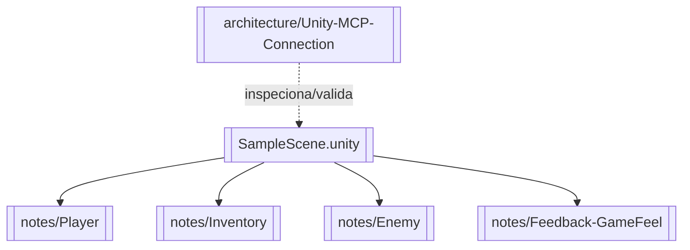

# World & Scenes

Organização de cenas, prefabs e assets do mundo. Índice: [[MOC]].

## Cena principal

- `Assets/Scenes/SampleScene.unity` — cena atual de integração e teste dos sistemas (jogador, sacola/itens, inimigos, navegação).

## Assets e pastas relevantes

- **Animations/** — animações de personagens/itens.
- **Models/** — modelos 3D.
- **Materials/**, **Textures/** — aparência visual.
- **Prefabs/** — objetos reutilizáveis (ex.: `Bullet.prefab`, itens).
- **Minimap/** — recursos de minimapa.
- **Settings/** — configurações de projeto/render (ex.: `DefaultVolumeProfile.asset`, URP).
- **Scripts/** — lógica por domínio (ver [[architecture/Overview]]).
- `InputSystem_Actions.inputactions` — mapa de ações de entrada.

## Integração em cena
- Ponto de encontro de [[notes/Player]], [[notes/Inventory]] e [[notes/Enemy]].
- Palco para feedback e legibilidade em world-space/câmera (prompts, highlights, sinalização 3D de dano/estado, vida baixa) conforme [[notes/Feedback-GameFeel]] e [[architecture/Decisions/ADR-0003-feedback-world-space]].
- Placeholders visuais simples são aceitáveis para validar comportamento.

## Validação e tooling
- Controlável/inspecionável via editor conectado: [[architecture/Unity-MCP-Connection]].
- Registrar resultados de integração e sessões de teste em [[notes/Playtest-Log]].

## Relações (conceitual)

